# リージョン間Active–Standbyフェイルオーバーの設計と業務判断

**速く切り替える価値と、失う・分岐するデータの影響を、同じ業務判断として設計する。**

Aurora Global Databaseは非同期複製であり、障害時の旧ライター排除もベストエフォートである。分断中でも昇格・再開する前提なら、**監視の多重化だけでデータロスとsplit brainを100%排除することはできない**。[5] 自動化には復旧を速める価値があるが、対象データ・障害条件・確認不能時の方針が必要になる。

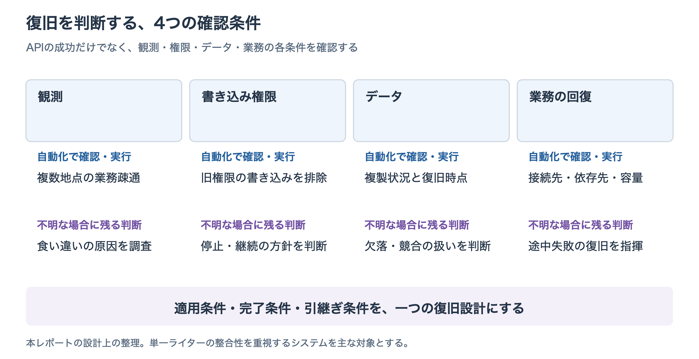

| 本レポートの流れ | 確認する問い |
|---|---|
| 1. 採用事例 | なぜ、リスクの残る自動化を選んだのか |
| 2–3. 仕組みと限界 | 何を監視・制御しても、何が残るのか |
| 4–5. 業務判断と事故 | 何を受け入れ、どう回復するのか |
| 6–7. 実行と体制 | 誰が例外を引き取り、能力を維持するのか |

改訂・資料確認：2026年11月22日。対象は主に非同期複製・単一ライターのリージョン間DR。**公開事実／本レポートの考察／未確認事項**を区別する。図はPNG画像で、折りたたみ内にも補足図を掲載した。

## 1. 具体的な自動化事例：同じ構成でも、採用理由は違う

**「ほぼ読み取り専用」「欠損・分岐が問題にならない業務だから」とは、公開資料から一般化できない。** 確認できるのは、復旧時間への要求と、閉塞・アクセス制御・試験への投資である。

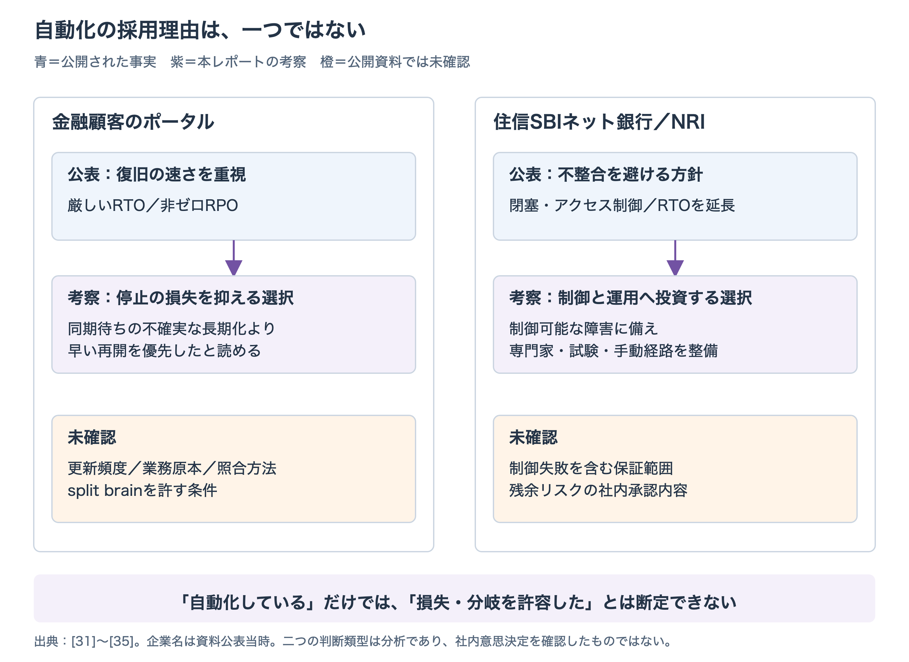

### 1.1 大手金融顧客のポータル：人の判断待ちではRTOを満たせない

AWSは、資産管理ポータルでの**検知・発動・切替の自動化**を紹介する。停止は事業損失に直結し、人の判断を待つ時間が許容されないことが理由である。[34]

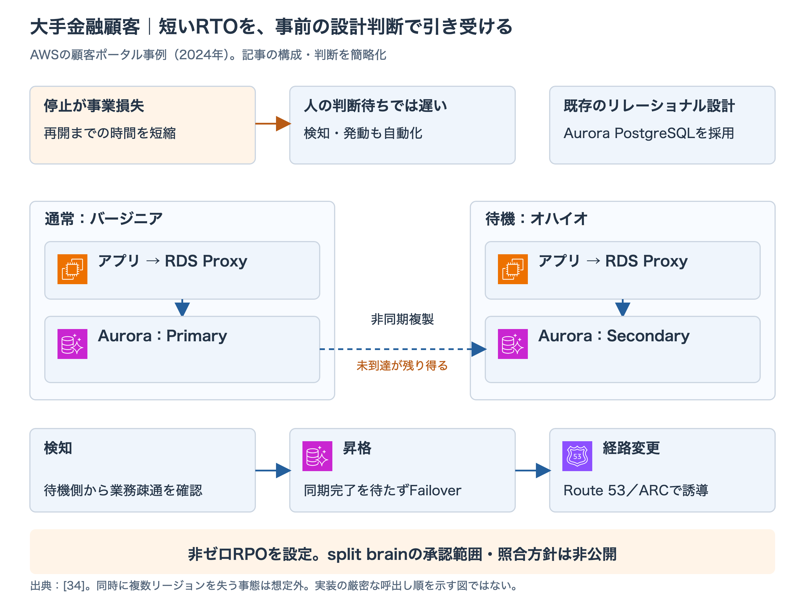

| 公開事実 [34][35] | 業務判断としての読み方 |
|---|---|
| 非ゼロRPOを設定し、同期を待つSwitchoverではなくFailoverを選択 | 待機の長期化より早い再開を優先する設計 |
| 高度に正規化したリレーショナルスキーマが必要 | 復旧だけでなく既存アプリの要件も製品選択を制約 |
| 待機側は健全、複数リージョン同時障害は想定外 | 自動化は特定の障害モデルで成立させている |
| 関連サンプルは `AllowDataLoss=True` | 損失を許容するAPI選択。顧客本番と完全同一とは限らない |

**未確認**：更新頻度、金融取引台帳の範囲、欠損の照合方法、split brainの承認条件。記事のRPOは本文と一覧で不一致のため、正確な承認値は断定しない。復旧約2分は試験結果であり、全障害時の保証ではない。[34]

### 1.2 住信SBIネット銀行／NRI：不整合を避けるため、制御と運用に投資する

導入インタビューは、一定の停止よりデータ不整合を避ける方針を明記する。閉塞・アクセス制御・DNS対策を織り込み、RTO目標を3分から5分へ変更した。**「データロスが問題にならないから採用した」という説明には合わない。**[32]

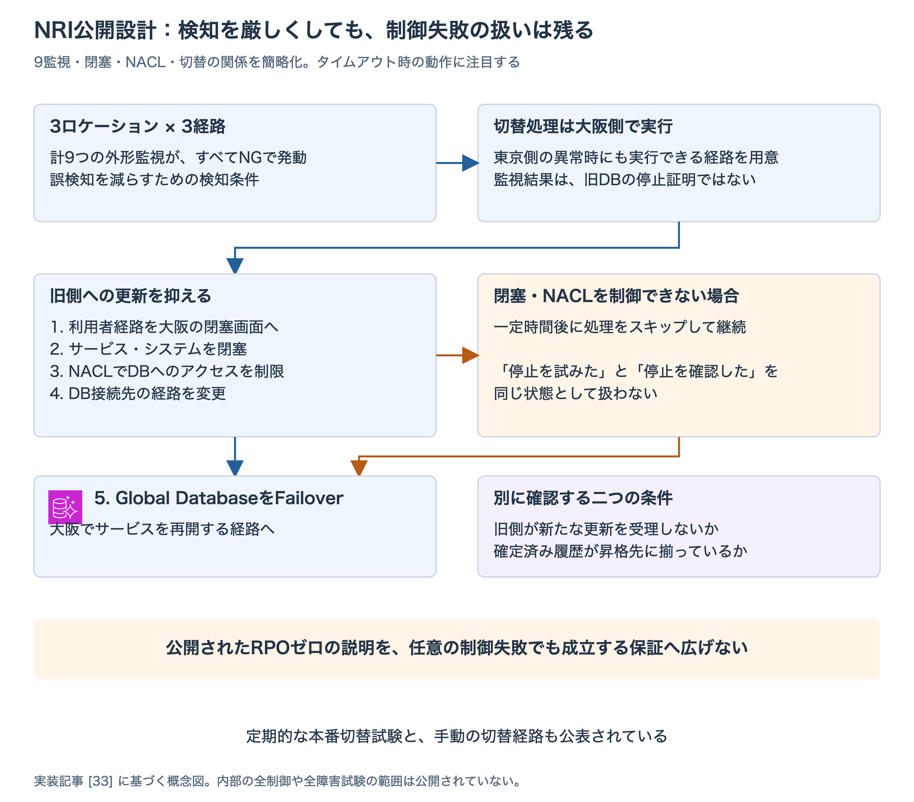

| 公開された設計・運用 [32][33] | その意味と限界 |
|---|---|
| 3ロケーション×3経路、全9監視のNGで発動 | 誤発動を抑える設計。旧DBの停止を証明するものではない |
| 閉塞・アクセス制御を経て昇格 | 旧側の継続書き込みを抑える投資 |
| 制御不能時はタイムアウト後にスキップ | 未確認のまま進むケースの扱いを別途評価する必要 |
| 手動切替・本番の定期試験を用意 | 自動化と並行して復旧能力を維持 |

**考察**：制御可能な障害と専門家・訓練を前提に、迅速な復旧を実装したと読める。ただし、社内の残余リスク承認内容は非公開。2024年2月の導入記事時点では実災害による自動DR発動は未経験であり、任意の分断からの無損失回復実績とは区別する。[32]

RPOゼロの読み方：プレスリリース・導入記事・実装記事を分ける

| 資料 | RPOに関する記載の範囲 |
|---|---|
| 同行プレスリリース（2023年8月）[31] | 「バックアップデータ」のRPOゼロ。対象の詳細は未定義 |
| NRI導入記事（2024年2月）[32] | 閉塞・書き込み停止と切替時RPOゼロを説明。閉塞失敗時の乖離にも言及 |
| NRI実装記事（2024年9月、追記あり）[33] | 手順、タイムアウト時の継続、手動経路を具体化 |

プレスリリースの記載を、全業務の確定済み更新・可視性・二重ライターに対する無条件の保証へ拡張しない。逆に、公開情報の不足だけで当該システムが公表目標を達成していないとも断定しない。企業名は資料公表当時のものを使う。

### 1.3 「自動化」の対象を取り違えない

| 例 | 自動化として確認できる範囲 |
|---|---|
| 上記の金融顧客／住信SBIネット銀行・NRI | リージョン間の検知・発動を含む切替 [32][33][34] |
| MonotaROの基幹DB | 記事で自動と明記されるのはリージョン内HA。リージョン間はSwitchover・手動Failover [36] |
| 公開サンプル・チュートリアル | 実装方法の例。顧客の本番採用・業務承認の証拠にはならない |

MonotaROは参照専用ではないが、無人のリージョン間発動の証拠にも数えない。

## 2. なぜ難しいのか：観測・保存・可視性は別の条件

### 2.1 タイムアウトは、相手の停止を証明しない

相手の停止、経路の分断、遅延、応答だけの消失は、同じ無応答になり得る。書き込みは完了済みかもしれず、再試行には冪等性・結果確認も必要になる。[1][2]

| 監視からの見え方 | 実際に残り得る状態 |
|---|---|
| 監視だけ無応答 | 既存アプリは旧Primaryへ書き込み可能 |
| 軽い疎通だけ成功 | 業務の更新処理は失敗 |
| 一部経路だけ失敗 | 正常な利用者と利用不能な利用者が共存 |

これはGray Failureの観測差とも関係する。[3] 多地点監視は判断材料を増やすが、共通依存や見えない書き込み経路まで消すわけではない。

AWSアイコンで見る：監視経路・接続経路・書き込み権限

AWSの内部実装図ではなく、観測経路と実際の更新経路を分ける概念図。

### 2.2 RPOゼロでも、直ちに最新値を読めるとは限らない

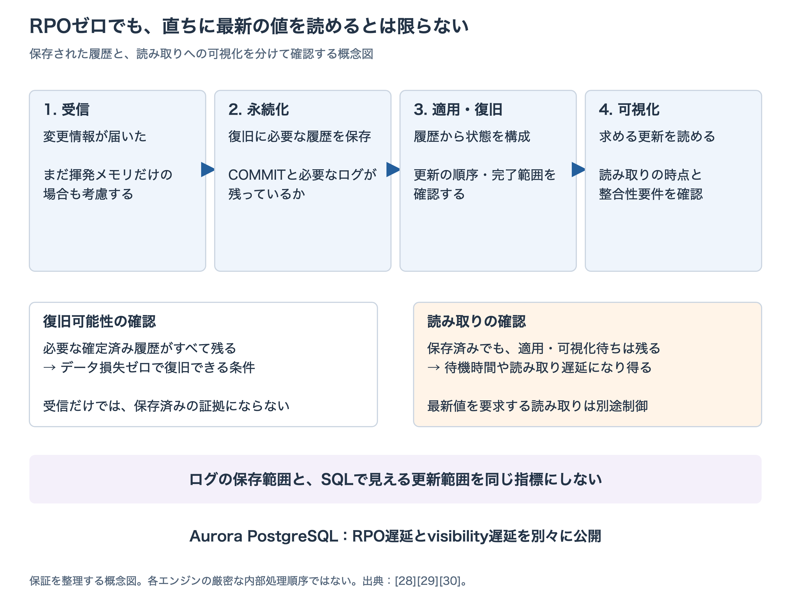

| 確認したこと | それだけでは保証しないこと |
|---|---|
| 変更情報が到達 | COMMITを含む必要な履歴の永続化 |
| 必要な履歴を永続化 | SQLでの適用・可視化の完了 |
| ある時点のRPO遅延がゼロ | その後の更新を含む継続的な損失ゼロ |
| 特定データのRPOゼロ | DB外も含む業務全体の無損失回復 |

Aurora PostgreSQLも、`rpo_lag_in_msec`と`visibility_lag_in_msec`を別々に提供する。[28][29] 両者は同じ更新履歴に関係するが同義ではない。最新の確定済み更新を読ませるには待機が必要になる場合があり、write forwardingの`GLOBAL`モードも反映を待つ。[30]

図は保証を整理する概念図。Auroraのリージョン間複製はストレージ層の変更の複製で、SQLリクエストの単純な再実行ではない。[37] 規定の分離レベルによる古いスナップショットも、可視性の不具合と混同しない。

### 2.3 分断中の「待つ／再開する」には制約がある

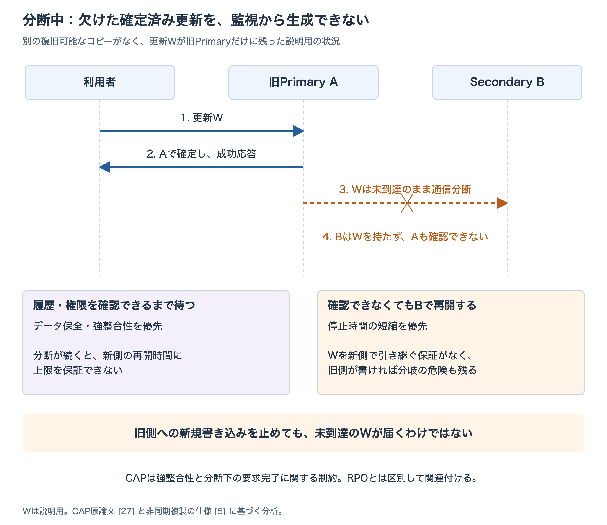

| 選択 | 引き受ける制約 |
|---|---|
| 必要な履歴・権限を確認するまで待つ | 分断が続けば、その側の復旧時間上限を保証できない |
| 確認できないまま昇格・再開する | 確定済み更新の引継ぎや、全体の強整合性を保証できない |

CAPのCは線形化可能性、Aは障害停止していないノードに届く各要求の最終的な完了である。分断を許すモデルでの両立制約であり、通常時の両立不可能や稼働率の定義ではない。[27] RPOとCは異なるが、何を確定し、どの履歴を読ませるかを通じて関係する。

失敗検知器・FLP・部分同期・Raftの研究も、モデルと成立条件を明示するために読む。「自動フェイルオーバーは不可能」という結論ではない。[1][14][15][16]

## 3. Aurora：欠損・旧ライター・経路変更を別々に確認する

### 3.1 片方のリスクを抑えても、もう片方は残る

| リスク | 起きる状態 | 防止に必要な条件 |
|---|---|---|
| データロス | 確定済み更新が昇格先にない | 必要な履歴の保全・引継ぎ |
| split brain | 新旧が更新を受理し履歴が分岐 | 競合する旧ライターの排除 |

旧側が完全停止していても未複製データは残り得る。逆に、切替直前まで複製済みでも、その後の独立した更新で分岐し得る。

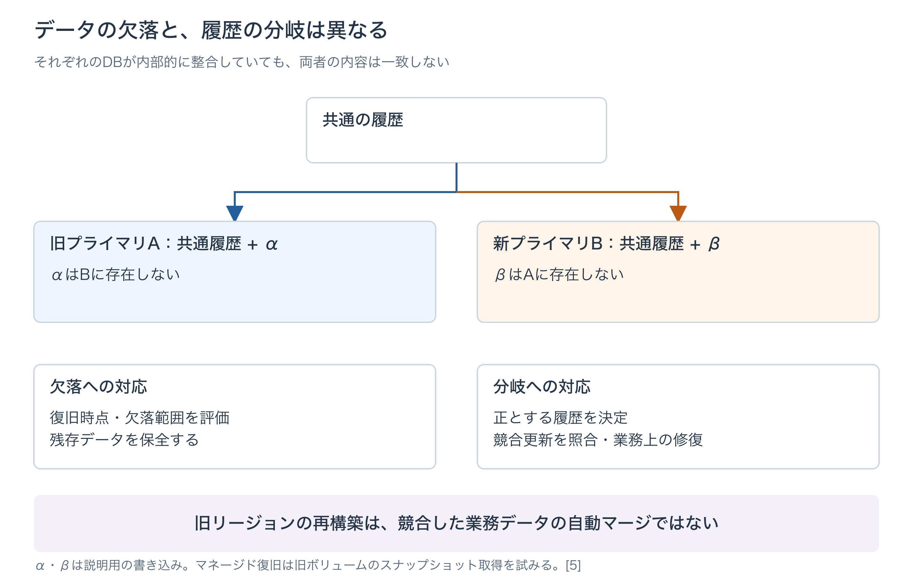

**切戻しが簡単かではなく、両側の業務データを回復できるかを問う。** 新側で更新を受理した後、DNSを戻すだけでは双方の履歴を引き継げない。

### 3.2 Managed failoverでも、旧書き込み排除はベストエフォート

| RDSイベント [6] | 読み取れること／読み取れないこと |
|---|---|
| `0390`：書き込みブロック成功 | 未複製データの不存在までは示さない |
| `0391`：ブロックがタイムアウト、処理継続 | 旧側が一時的に更新を受理し得る。停止成功として扱わない |
| `0397`：Global writer endpointのDNS更新 | 既存接続の消滅・フェンシング成功とは別 |

AWSは、Failoverが同期完了を待たないことと、フェンシング失敗の可能性を明記する。[5] `0391`は開始後の通知であり、受信時に必ず昇格前へ戻せる仕組みではない。

TTL短縮・再接続は移行を速める。旧ライター対策では、Webだけでなくバッチ・キュー・直接接続も扱う。[7][8]

用語と操作：人の承認・Manual failover・Switchoverは別の軸

| 軸 | 選択肢 |
|---|---|
| 誰が開始を判断するか | 人／事前承認した自動条件 |
| 障害復旧で何を呼ぶか | Managed failover／Manual failover |
| 健全な構成で同期を待つか | Switchover／障害時のFailover |

人の承認後にManaged failoverを使うこともできる。AWSはDRにManaged failoverを推奨する。[5] 健全な構成で同期を待つSwitchoverの損失ゼロを、災害時Failoverへ一般化しない。

Secondaryのデタッチは独立した読み書き可能クラスタを作る操作で、旧Primary停止の操作ではない。[4] 図はAWSの推奨手順ではない。

## 4. 自動開始を、何に基づいて許容するか

### 4.1 三つの仮説は合理的な候補だが、事例からの裏付けは異なる

| 仮説 | 成立しやすい条件 | 今回の事例から言えること |
|---|---|---|
| ほぼ読み取り専用 | 欠ける更新が少なく、古い読み取りの影響も小さい | 2事例の更新頻度は未公表。採用理由とは断定できない |
| 損失・分岐の回復が容易 | 別原本・再計算・冪等な再処理・照合がある | 具体的な業務回復手順は未確認 |
| 停止より再開を優先 | 停止損失が大きく、許容損失を定義できる | 金融ポータルは明確に支持。銀行事例は不整合回避を重視 |
| 制御と運用へ投資する | 旧側停止、複製確認、試験、例外対応を維持できる | NRI事例が具体的な実装・運用を示す |

参照比率が高くても更新の絶対量は多いかもしれず、権限取消などは少数の欠落でも重大になる。**非ゼロRPOの承認と、履歴分岐の承認も別である。** 純粋な読み取り継続では二重ライターは生じないが、昇格後も書かないことと、普段の参照比率は区別する。

### 4.2 比較対象は「自動なら危険、人なら安全」ではない

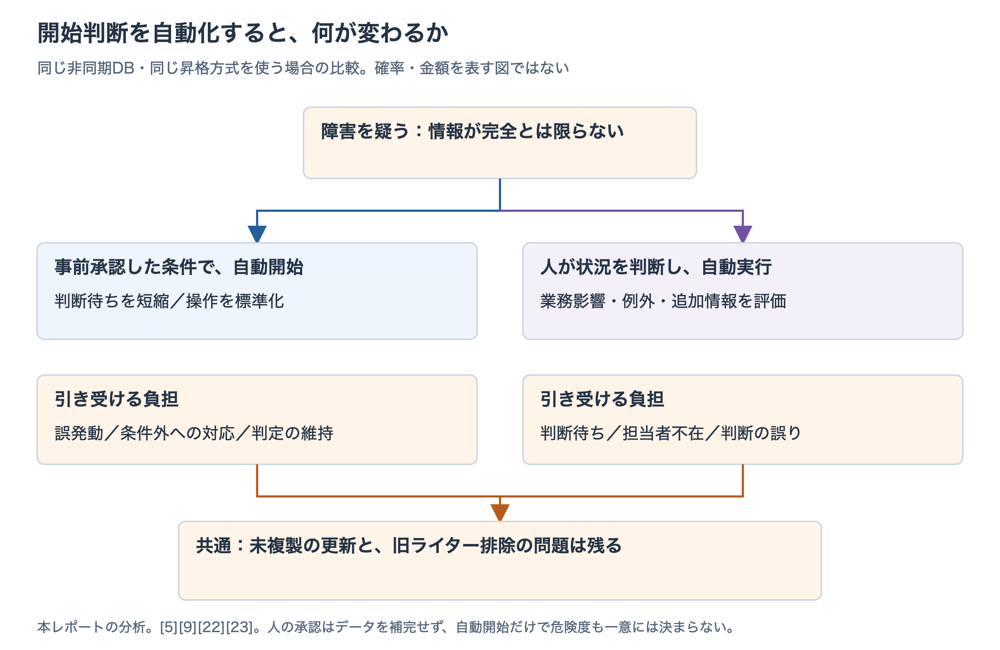

| 業務として決める事項 | 具体化する単位 |
|---|---|
| 停止をどこまで待てるか | 業務別の期限・顧客影響・契約・売上 |
| 何を失えるか | 対象データ・件数・金額・補償範囲 |
| 分岐をどう扱うか | 正とする原本・重複検出・外部副作用の照合 |
| 不明ならどうするか | 待機／縮退／例外的再開と、その判断権限 |

同じ昇格方式なら、人が承認しても未複製データは補えない。自動開始は判断待ちを短縮し、誤発動や適用範囲の維持を引き受ける選択になる。

設計例：自動開始を検討できる条件と、条件不足時の分岐

外部原本から再処理する設計も、原本が同じ障害で失われず、未配送・重複・決済や通知を照合できることが条件となる。[37] 公開事例の存在は、自社でもその条件を満たせる証拠にはならない。非公開の意思決定を、合理的だったと推測して埋め合わせない。

## 5. 公開事故：切替が終わっても、業務の復旧は終わらない

以下はAurora固有の事故集ではなく、自動化の適用範囲外と復旧能力の必要性を示す比較事例である。

| 公開事例 | 自動化・冗長化の外に残ったもの | 教訓 |
|---|---|---|
| GitHub・2018年 [12] | 自動切替後、双方に固有の更新が残存 | 即時切戻しを避け、履歴保全と復旧を判断 |
| Google Cloud・2019年 [19] | ネットワーク障害が復旧ツールにも波及 | 代替の調査・操作経路を用意 |
| Cloudflare・2023年 [20] | 施設全体喪失と隠れた依存 | 部品だけでなく復旧経路全体を試験 |
| GitLab・2016年 [11] | 制御ソフト停止後もDBが動作 | 人への引継ぎにも状態確認と手順が必要 |

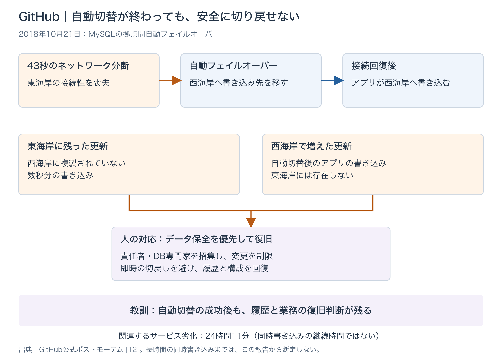

GitHubの24時間11分はサービス劣化の継続時間で、同時書き込みの継続時間ではない。[12] DNSの切戻しだけで回復できない理由を示す。

3件の事故を図で見る：Google Cloud／Cloudflare／GitLab

出典：[19]。全リージョン停止を意味しない。

出典：[20]。主な対象はコントロールプレーン・分析で、全エッジ停止ではない。

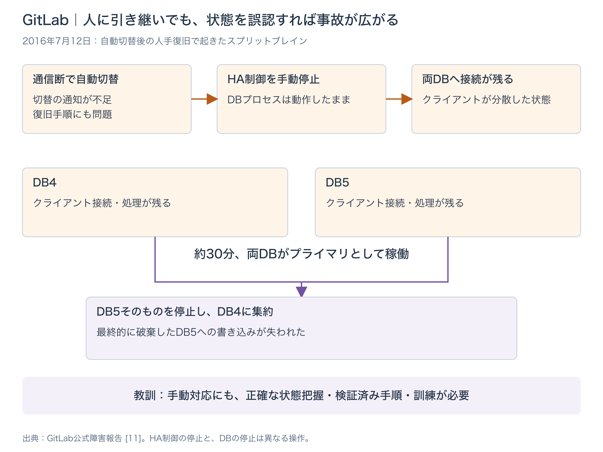

出典：[11]。関連するMySQL自動化事故の分析はSREcon発表も参照。[13]

今回の調査では、Auroraのsplit brainについて確証を持って引用できる詳細な公開事故報告は特定していない。**公式仕様上のリスクと、確認された事故を区別する。** 事故が存在しないという意味ではない。

## 6. 自動実行と、例外を引き取る人を一つの設計にする

### 6.1 開始判断と、手順の自動化を分ける

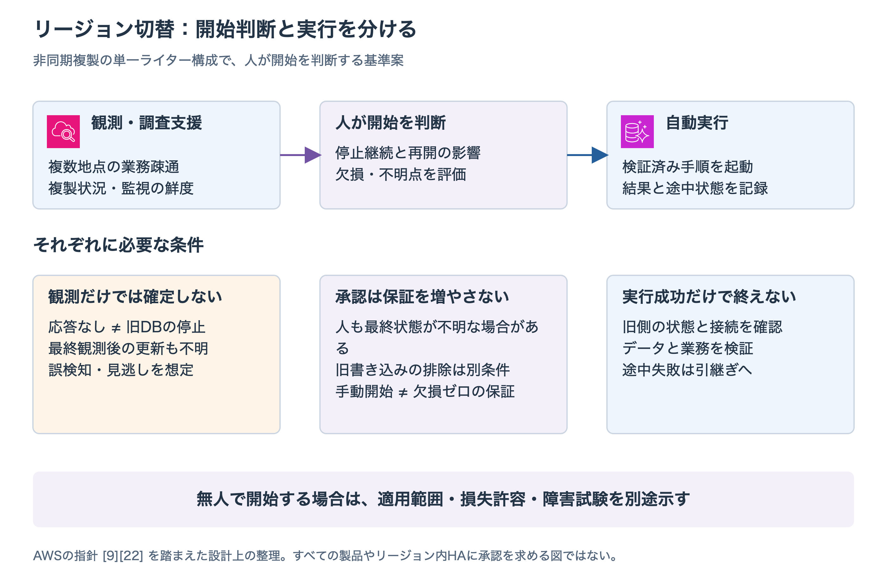

AWSの一般指針は、データ損失等を考慮した人の発動判断と、切替操作の自動化を勧める。[9][22] DB向け指針には全自動・部分自動の選択肢もある。[23]

本レポートでは整合性を重視する非同期構成の基準案を、**人が開始を判断し、検証済み手順を自動実行する方式**とする。厳しいRTOから自動開始する場合は、適用条件・残余リスク・例外の引継ぎを事前に承認する。

### 6.2 API成功から、業務再開・照合まで追う

| 段階 | 完了・引継ぎに必要な証拠 |
|---|---|
| 検知・開始判断 | 業務疎通、監視の鮮度、複製状態、停止継続との比較 |
| 旧側の制御 | 成功した停止と、未確認の書き込み経路 |
| 昇格・再開 | 呼んだAPI、イベント、DBの役割、可視性、接続・依存先 |
| 業務回復 | 残存履歴の保全、欠損・分岐・外部処理の照合 |

自社の後続操作を保留できても、開始済みのAurora側処理を必ず停止できるわけではない。照合前に再開する業務と、照合まで止める業務も決める。

ARCの注意点：Graceful・承認ブロックもデータ保証とは別

| 確認事項 | 公開仕様 |
|---|---|
| 公式チュートリアルのDB操作 | 健全な構成でのSwitchover [24] |
| GracefulでFailoverを選択 | `AllowDataLoss=true`で実行され得る [26] |
| Ungracefulの手動承認 | Manual approvalブロックは非対応 [25] |

モード名・承認の存在は、非同期複製やフェンシングの性質を変えない。

### 6.3 オンコールは、連絡先ではなく復旧できる能力

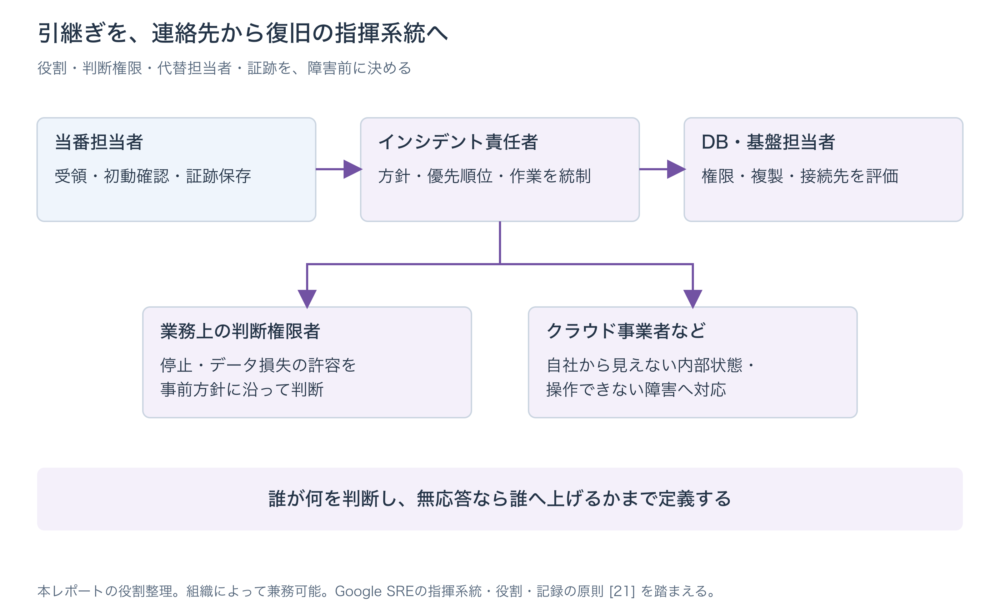

| 人へ引き取る状態 | 用意する能力 |
|---|---|
| 観測の矛盾・旧側や履歴が不明 | 切り分け、待機・縮退・例外的再開の判断 |
| 途中失敗・反復切替 | 再開点の確認、二重実行の防止、復旧の指揮 |
| 管理API・認証・通常ツールも停止 | 代替経路、緊急権限、事業者への連絡 |
| 欠損・分岐が判明 | 原本の選択、業務照合、顧客対応・補償 |

Google SREも手動介入能力の維持と指揮・役割を重視する。[18][21] 全切替に人の承認が必要という定理ではないが、**自動化の範囲外を組織が引き取る設計は残る。** 当番不在時の代替と定期訓練まで含める。

## 7. 自社が維持できる方式を選ぶ

### 7.1 強整合な基盤では、難しい判断の一部を委ねられる

| 観点 | Aurora Global Database | Spanner／Aurora DSQLの該当構成 |
|---|---|---|
| 確定と複製 | リージョン間は非同期 | 同期的な複製・合意・確定をプロトコルで扱う |
| 障害時の課題 | 未確認の履歴を残した昇格判断 | 必要な合意条件を失った側では処理が進まない |
| 利用者の仕事 | 発動・旧側制御・接続・業務照合 | 接続・再試行・依存先・アプリの回復等 |

SpannerはリーダーとPaxos複製、DSQLは強整合な複数リージョンエンドポイントと自動復旧を説明する。[41][42] 非同期Secondaryの強制昇格に伴う問題を減らせるが、CAPを回避せず、耐えられる障害条件がある。DSQLでもアプリの経路選択は必要である。[43] 誤SQLやDB外の副作用まで安全になるわけではない。

### 7.2 Googleの仕組みには、それを維持する人員と時間も含まれる

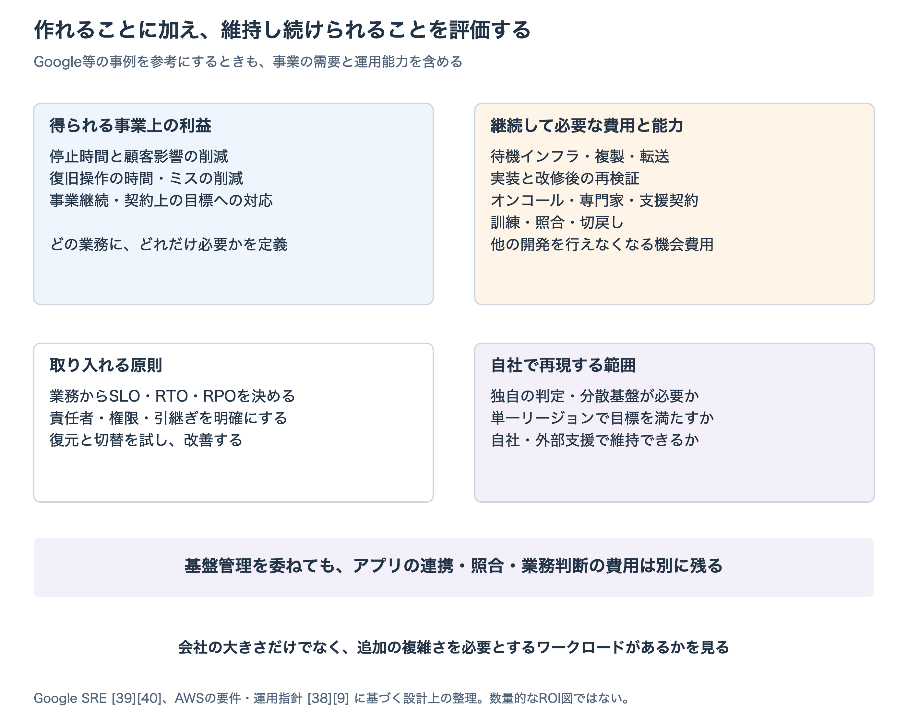

| 自社で継続できるか | 評価に含めるもの |
|---|---|
| 障害判定・切替を保守できる | 変更後の試験、部分分断、管理API失敗、古い監視値 |
| 例外から回復できる | 夜間招集、専門家・外部支援、照合・切戻し訓練 |
| 複雑化の利益が費用を上回る | 設備に加え開発・維持・訓練・他業務の機会費用 |

Google SREの組織モデルには、開発能力と改善に使う時間の確保が含まれる。[39][40] 会社の規模ではなく、停止の影響と維持能力で決める。AWSも要件を先に確認し、多くの目標は単一リージョンで達成できると説明する。[38]

### 7.3 生成AIも、観測・制御・検証を省略する根拠にはならない

設計上の提案として、AIはログ要約・仮説提示・承認済み手順の実行を支援できる。しかし、もっともらしい説明は原因や修復成功の保証ではない。権限・停止条件・結果確認・監査記録を定め、例外を引き取る能力を残す。未転送データや欠けた観測を推論で回復できるわけではない。

### 7.4 設計レビュー：この6問に答えられるか

| 問い | 決めておくもの |
|---|---|
| 何を守るか | データの対象、確定条件、鮮度、業務のRPO・RTO |
| どこまで耐えるか | 分断、旧側継続、管理API停止、複数拠点障害 |
| いつ始めるか | 自動条件または判断者、確認不能時の方針 |
| 何をもって再開するか | 旧書き込みの排除、履歴・可視性、依存先・容量 |
| 欠損・分岐をどう直すか | 原本、保全、照合、再処理、外部副作用の補償 |
| 誰が維持するか | 当番、代替担当、専門家、定期試験・訓練の時間 |

**採用事例から学ぶのは、自動化したという結果だけでなく、要求・成立条件・残るリスク・復旧能力の組合せである。**

## 参考資料と根拠の扱い

製品仕様は変更され得る。事例の数値は記事の時点・対象・条件に限定する。図のW・α・βは説明用で、配置・長さも測定値ではない。公開資料に基づく概念図であり、非公開の内部保証を補っていない。

43件の一次資料・公式仕様・公開事故報告

1. [Chandra・Toueg：Unreliable Failure Detectors for Reliable Distributed Systems](https://ecommons.cornell.edu/entities/publication/7948ff49-7263-49f8-a29b-d062e7cbb240)
2. [AWS Builders’ Library：Leader election in distributed systems](https://d1.awsstatic.com/builderslibrary/pdfs/leader-election-in-distributed-systems.pdf)
3. [Huangほか：Gray Failure: The Achilles’ Heel of Cloud-Scale Systems](https://www.microsoft.com/en-us/research/wp-content/uploads/2017/06/paper-1.pdf)
4. [AWS：Removing a cluster from an Amazon Aurora global database](https://docs.aws.amazon.com/AmazonRDS/latest/AuroraUserGuide/aurora-global-database-detaching.html)
5. [AWS：Using switchover or failover in Amazon Aurora Global Database](https://docs.aws.amazon.com/AmazonRDS/latest/AuroraUserGuide/aurora-global-database-disaster-recovery.html)
6. [AWS：Amazon RDS event categories and event messages for Aurora](https://docs.aws.amazon.com/AmazonRDS/latest/AuroraUserGuide/USER_Events.Messages.html)
7. [AWS：Connecting to Amazon Aurora Global Database](https://docs.aws.amazon.com/AmazonRDS/latest/AuroraUserGuide/aurora-global-database-connecting.html)
8. [AWS：Best practices for routing control in ARC](https://docs.aws.amazon.com/r53recovery/latest/dg/route53-arc-best-practices.regional.html)
9. [AWS：Multi-Region fundamental 4: Operational readiness](https://docs.aws.amazon.com/prescriptive-guidance/latest/aws-multi-region-fundamentals/fundamental-4.html)
10. [AWS：Data and control planes for routing control](https://docs.aws.amazon.com/r53recovery/latest/dg/data-and-control-planes.html)
11. [GitLab：Postgres DB Split brain incident led to data loss — postmortem](https://gitlab.com/gitlab-com/gl-infra/production/-/issues/48)
12. [GitHub：October 21 post-incident analysis](https://github.blog/news-insights/company-news/oct21-post-incident-analysis/)
13. [USENIX SREcon 2019：Autopsy of a MySQL Automation Disaster](https://www.usenix.org/conference/srecon19emea/presentation/gagne)
14. [Fischer・Lynch・Paterson：Impossibility of Distributed Consensus with One Faulty Process](https://www.cs.cornell.edu/courses/cs5414/2017fa/papers/fischer.pdf)
15. [Dwork・Lynch・Stockmeyer：Consensus in the Presence of Partial Synchrony](https://dspace.mit.edu/entities/publication/108bf327-aff6-414b-a48f-b357a821c48e)
16. [Ongaro・Ousterhout：In Search of an Understandable Consensus Algorithm](https://raft.github.io/raft.pdf)
17. [AWS公式アーキテクチャアイコン](https://aws.amazon.com/jp/architecture/icons/)
18. [Google SRE：The Evolution of Automation at Google](https://sre.google/sre-book/automation-at-google/)
19. [Google Cloud：Networking Incident #19009（2019年6月2日）](https://status.cloud.google.com/incident/cloud-networking/19009)
20. [Cloudflare：Post mortem on the Cloudflare Control Plane and Analytics Outage（2023年11月2日）](https://blog.cloudflare.com/post-mortem-on-cloudflare-control-plane-and-analytics-outage/)
21. [Google SRE Workbook：Incident Response](https://sre.google/workbook/incident-response/)
22. [AWS Well-Architected：REL13-BP02 Use defined recovery strategies to meet the recovery objectives](https://docs.aws.amazon.com/wellarchitected/latest/framework/rel_planning_for_recovery_disaster_recovery.html)
23. [AWS：Automating your disaster recovery strategy](https://docs.aws.amazon.com/prescriptive-guidance/latest/strategy-database-disaster-recovery/automating.html)
24. [AWS ARC：Tutorial: Create an active/passive Region switch plan](https://docs.aws.amazon.com/r53recovery/latest/dg/tutorial-region-switch.html)
25. [AWS ARC：Manual approval execution block](https://docs.aws.amazon.com/r53recovery/latest/dg/manual-approval-block.html)
26. [AWS ARC：Amazon Aurora Global Database execution block](https://docs.aws.amazon.com/r53recovery/latest/dg/aurora-global-database-block.html)
27. [Gilbert・Lynch：Brewer’s Conjecture and the Feasibility of Consistent, Available, Partition-Tolerant Web Services](https://www.comp.nus.edu.sg/~gilbert/pubs/BrewersConjecture-SigAct.pdf)
28. [AWS：aurora_global_db_status（RPO・永続化の遅延）](https://docs.aws.amazon.com/AmazonRDS/latest/AuroraUserGuide/aurora_global_db_status.html)
29. [AWS：aurora_global_db_instance_status（受信・永続化・可視化）](https://docs.aws.amazon.com/AmazonRDS/latest/AuroraUserGuide/aurora_global_db_instance_status.html)
30. [AWS：Using write forwarding in an Aurora PostgreSQL global database](https://docs.aws.amazon.com/AmazonRDS/latest/AuroraUserGuide/aurora-global-database-write-forwarding-apg.html)
31. [住信SBIネット銀行：AWSマルチリージョン化のプレスリリース（2023年8月29日）](https://www.netbk.co.jp/contents/company/press/2023/0829_001840.html)
32. [NRI：住信SBIネット銀行の導入事例（2024年2月1日）](https://atlax.nri.co.jp/cases/20240201_aws/)
33. [NRI：Aurora Global Databaseを利用したDR自動切り替えについて（2024年9月10日、追記あり）](https://atlaxblogs.nri.co.jp/entry/20240910)
34. [AWS：How a large financial AWS customer implemented HA and DR for Aurora PostgreSQL（2024年9月27日）](https://aws.amazon.com/blogs/database/how-a-large-financial-aws-customer-implemented-ha-and-dr-for-amazon-aurora-postgresql-using-global-database-and-amazon-rds-proxy/)
35. [AWS公開サンプル：FailoverClusterPromoter.py（コミット固定）](https://github.com/aws-samples/amazon-aurora-postgresql-fast-failover-demo/blob/9c73ac180d19e41e5815f29add885b1069057473/lambda-functions/FailoverClusterPromoter.py)
36. [AWS：MonotaROのAurora Global Database移行事例（2026年8月26日）](https://aws.amazon.com/jp/blogs/news/monotaro-core-database-migration-to-amazon-aurora-global-database/)
37. [AWS：Multi-Region fundamental 2: Understanding the data](https://docs.aws.amazon.com/prescriptive-guidance/latest/aws-multi-region-fundamentals/fundamental-2.html)
38. [AWS：Multi-Region fundamental 1: Understanding the requirements](https://docs.aws.amazon.com/prescriptive-guidance/latest/aws-multi-region-fundamentals/fundamental-1.html)
39. [Google SRE：Introduction（人材・改善時間の確保）](https://sre.google/sre-book/introduction/)
40. [Google SRE：Embracing Risk（信頼性と機会費用）](https://sre.google/sre-book/embracing-risk/)
41. [Google Cloud：Spanner replication](https://docs.cloud.google.com/spanner/docs/replication)
42. [AWS：Resilience in Amazon Aurora DSQL](https://docs.aws.amazon.com/aurora-dsql/latest/userguide/disaster-recovery-resiliency.html)
43. [AWS：Implement multi-Region endpoint routing for Amazon Aurora DSQL](https://aws.amazon.com/blogs/database/implement-multi-region-endpoint-routing-for-amazon-aurora-dsql/)

### 図の形式・再利用

全24点をPNGで掲載し、`images`に編集用SVGを保存した。Markdownの移動時は`images`も一緒に扱う。AWS構成図には公式アイコンを使用している。[17]

[1]: https://ecommons.cornell.edu/entities/publication/7948ff49-7263-49f8-a29b-d062e7cbb240
[2]: https://d1.awsstatic.com/builderslibrary/pdfs/leader-election-in-distributed-systems.pdf
[3]: https://www.microsoft.com/en-us/research/wp-content/uploads/2017/06/paper-1.pdf
[4]: https://docs.aws.amazon.com/AmazonRDS/latest/AuroraUserGuide/aurora-global-database-detaching.html
[5]: https://docs.aws.amazon.com/AmazonRDS/latest/AuroraUserGuide/aurora-global-database-disaster-recovery.html
[6]: https://docs.aws.amazon.com/AmazonRDS/latest/AuroraUserGuide/USER_Events.Messages.html
[7]: https://docs.aws.amazon.com/AmazonRDS/latest/AuroraUserGuide/aurora-global-database-connecting.html
[8]: https://docs.aws.amazon.com/r53recovery/latest/dg/route53-arc-best-practices.regional.html
[9]: https://docs.aws.amazon.com/prescriptive-guidance/latest/aws-multi-region-fundamentals/fundamental-4.html
[10]: https://docs.aws.amazon.com/r53recovery/latest/dg/data-and-control-planes.html
[11]: https://gitlab.com/gitlab-com/gl-infra/production/-/issues/48
[12]: https://github.blog/news-insights/company-news/oct21-post-incident-analysis/
[13]: https://www.usenix.org/conference/srecon19emea/presentation/gagne
[14]: https://www.cs.cornell.edu/courses/cs5414/2017fa/papers/fischer.pdf
[15]: https://dspace.mit.edu/entities/publication/108bf327-aff6-414b-a48f-b357a821c48e
[16]: https://raft.github.io/raft.pdf
[17]: https://aws.amazon.com/jp/architecture/icons/
[18]: https://sre.google/sre-book/automation-at-google/
[19]: https://status.cloud.google.com/incident/cloud-networking/19009
[20]: https://blog.cloudflare.com/post-mortem-on-cloudflare-control-plane-and-analytics-outage/
[21]: https://sre.google/workbook/incident-response/
[22]: https://docs.aws.amazon.com/wellarchitected/latest/framework/rel_planning_for_recovery_disaster_recovery.html
[23]: https://docs.aws.amazon.com/prescriptive-guidance/latest/strategy-database-disaster-recovery/automating.html
[24]: https://docs.aws.amazon.com/r53recovery/latest/dg/tutorial-region-switch.html
[25]: https://docs.aws.amazon.com/r53recovery/latest/dg/manual-approval-block.html
[26]: https://docs.aws.amazon.com/r53recovery/latest/dg/aurora-global-database-block.html
[27]: https://www.comp.nus.edu.sg/~gilbert/pubs/BrewersConjecture-SigAct.pdf
[28]: https://docs.aws.amazon.com/AmazonRDS/latest/AuroraUserGuide/aurora_global_db_status.html
[29]: https://docs.aws.amazon.com/AmazonRDS/latest/AuroraUserGuide/aurora_global_db_instance_status.html
[30]: https://docs.aws.amazon.com/AmazonRDS/latest/AuroraUserGuide/aurora-global-database-write-forwarding-apg.html
[31]: https://www.netbk.co.jp/contents/company/press/2023/0829_001840.html
[32]: https://atlax.nri.co.jp/cases/20240201_aws/
[33]: https://atlaxblogs.nri.co.jp/entry/20240910
[34]: https://aws.amazon.com/blogs/database/how-a-large-financial-aws-customer-implemented-ha-and-dr-for-amazon-aurora-postgresql-using-global-database-and-amazon-rds-proxy/
[35]: https://github.com/aws-samples/amazon-aurora-postgresql-fast-failover-demo/blob/9c73ac180d19e41e5815f29add885b1069057473/lambda-functions/FailoverClusterPromoter.py
[36]: https://aws.amazon.com/jp/blogs/news/monotaro-core-database-migration-to-amazon-aurora-global-database/
[37]: https://docs.aws.amazon.com/prescriptive-guidance/latest/aws-multi-region-fundamentals/fundamental-2.html
[38]: https://docs.aws.amazon.com/prescriptive-guidance/latest/aws-multi-region-fundamentals/fundamental-1.html
[39]: https://sre.google/sre-book/introduction/
[40]: https://sre.google/sre-book/embracing-risk/
[41]: https://docs.cloud.google.com/spanner/docs/replication
[42]: https://docs.aws.amazon.com/aurora-dsql/latest/userguide/disaster-recovery-resiliency.html
[43]: https://aws.amazon.com/blogs/database/implement-multi-region-endpoint-routing-for-amazon-aurora-dsql/
