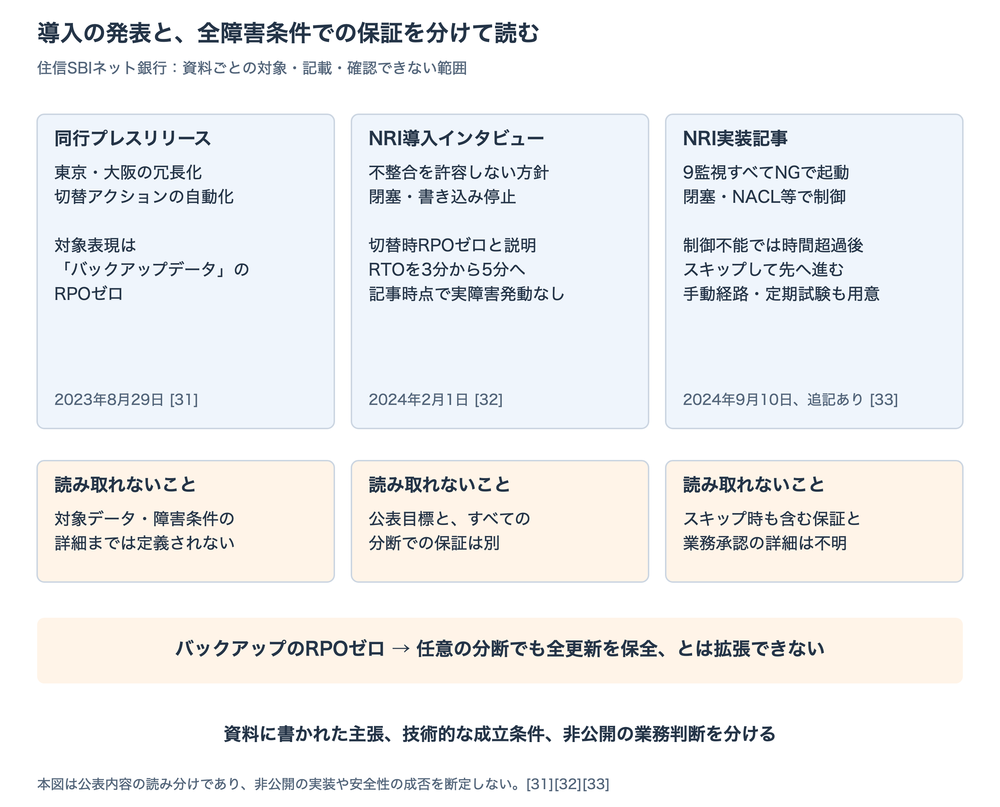
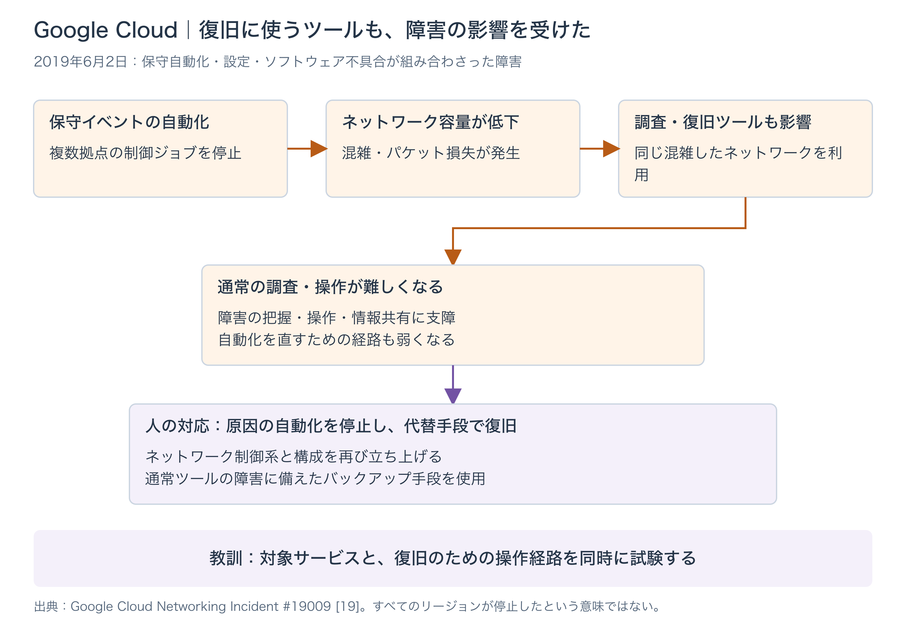
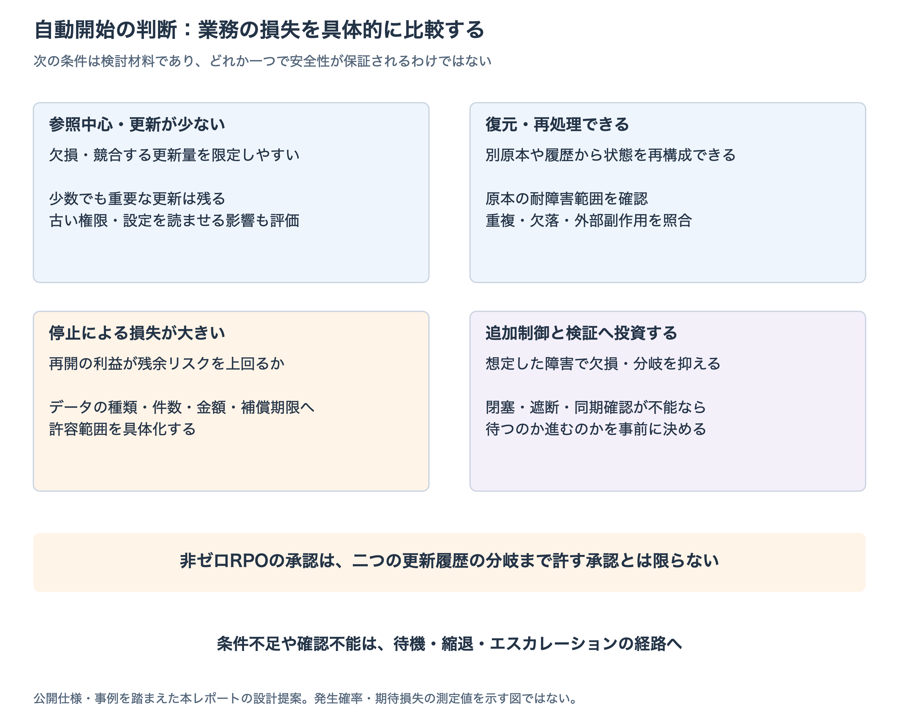
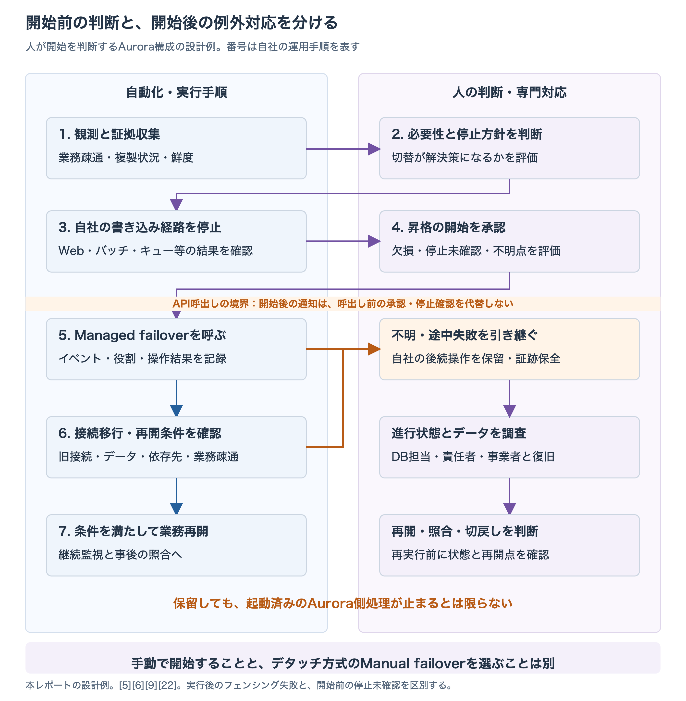

# リージョン間Active–Standbyフェイルオーバーの設計と業務判断

― Aurora Global Databaseの限界から、公開事例・自動化・運用体制を読み解く ―

改訂日・追加資料確認日：2026年11月22日。対象は主に、非同期複製する単一ライターのDBを、障害時に別リージョンへ昇格させる構成である。本文では、**製品の公開仕様、導入企業の公表内容、公開事故、本レポートの分析・設計提案**を区別する。

## 要旨：監視を増やしても、書き込み権限とデータの保証は増えない

**Aurora Global Databaseで、分断・障害時にも別リージョンを自動昇格して書き込みを再開する前提なら、監視の多重化だけでは、データロスとsplit brainのリスクを100%排除できない。** 非同期複製では成功応答済みの更新が昇格先に未到達の場合があり、Managed failoverの旧書き込み排除もベストエフォートだからである。[5]

だから自動化を使わない、という結論にはならない。定型操作の自動化は、復旧の迅速化と操作ミスの削減に役立つ。必要なのは、監視・制御で減らせるリスクと、なお残る不確実性を分け、**どの条件で再開を優先し、どの条件で待つかを業務として決めること**である。人の承認も、通信できないDBの最終状態を確定する手段にはならない。

| 読者が持ち帰る判断軸 | 本レポートで確認すること |
|---|---|
| 応答なしは停止の証拠か | 観測地点・経路による差と失敗検知の限界 |
| RPOゼロなら直ちに正しく読めるか | データの保存・適用・可視化と、保証対象の違い |
| 昇格すれば旧Primaryは止まるか | フェンシング、接続移行、未複製データを別々に確認 |
| 自動化事例は安全性の証明か | 公表された対象・条件・試験と、非公開の承認内容を区別 |
| どこまで自動化するか | 停止の損失、欠損・分岐の損失、復旧能力、維持費を比較 |

本文は、**観測の限界 → データとCAPの制約 → Auroraの具体的な挙動 → 導入事例と事故 → 業務判断 → 実行・運用設計**の順で進む。「自動化している」と「全障害条件で安全が保証される」を同一視せず、成立条件を追える構成にした。

## 1. 無応答から分かること、分からないこと

### 1.1 タイムアウトが示すのは、観測点からの無応答である

相手が停止した場合も、通信だけが途切れた場合も、応答だけが失われた場合も、送り手には同じタイムアウトとして見える。書き込みでは、応答がなくても実際の処理は完了している可能性がある。再試行には結果確認や冪等性も必要になる。[1][2]

図の陽性は「障害あり」という検知器の判断である。偽陽性は不要な切替、偽陰性は復旧の遅れにつながる。タイムアウトを短くすると検知は速まるが、遅延を故障と疑いやすくなる。監視点を増やすことは判断材料を増やすが、無応答から相手の停止を論理的に確定できるようにはならない。

### 1.2 監視経路と、実際の書き込み経路は一致しない

これはEC2・CloudWatch等を使った概念構成であり、AWSの内部実装ではない。

| 観測のずれ | 起こり得る状態 |
|---|---|
| 監視経路だけが障害 | 監視は無応答でも、既存アプリは旧Primaryに書き込める |
| ヘルスチェックだけが成功 | 軽い疎通は正常でも、業務の更新処理は失敗している |
| 一部の利用者・経路だけが障害 | 正常に使える利用者と、利用できない利用者が同時に存在する |

Gray Failureの論文は、このような利用者と観測者の見え方の差をdifferential observabilityとして整理している。[3] 多地点監視でも共通の依存先や監視基盤の障害は残るため、監視数だけで独立性や誤判定確率を計算しない。

**検知を完全にすることより、誤った疑いが起こり得ても危険な更新を確定させないことが重要になる。** ここで、データを保存する条件と、書き込み権限を排除する条件が問題になる。

## 2. RPO・可視性・CAPは、区別したうえで関連付ける

### 2.1 「届いた」「保存された」「読める」は同じ状態ではない

RPOは、障害後にどの時点まで復旧できるかというデータ損失の目標である。読み取りで何が見えるかという整合性とは別の軸だが、同じ複製履歴に依存するため、密接に関係する。

| 段階 | 確認する内容 | その段階だけでは分からないこと |
|---|---|---|
| 受信 | 変更情報が相手へ到達したか | 障害後も必要な情報が残るか |
| 永続化 | COMMITを含む復旧に必要な履歴が保存されたか | その更新を現在のSQLで読めるか |
| 適用・復旧 | 保存された履歴から正しいDB状態を構成できるか | 個々の読み取りのスナップショットに何が含まれるか |
| 可視化 | 求める更新が読み取りに見えるか | 他の操作も含む強整合性全体が成立しているか |

これは保証を整理する概念図であり、各エンジンが必ずこの順に独立処理するという内部実装図ではない。Auroraでは主にストレージ層の変更が複製され、SQLリクエストそのものが相手で再実行されるという説明ではない。[37]

必要な確定済み履歴をすべて保存できていれば、データを失わず復旧できても、適用・可視化を待つ時間は残り得る。逆に、パケットが届いた事実だけでは損失ゼロを主張できない。バックアップに含まれる対象が業務データの一部なら、その対象でのRPOを業務全体へ拡張することもできない。

### 2.2 Auroraも、RPOと可視化を別々に監視する

Aurora PostgreSQLの公開関数には、次の項目がある。MySQL側の項目名・意味と混同せず、利用するエンジンの仕様を確認する。[28][29]

| 項目 | AWSが説明する意味 | 評価する軸 |
|---|---|---|
| `rpo_lag_in_msec` | 最新のユーザートランザクションのCOMMITがSecondaryに保存されるまでの遅延 | 未保存の確定済み更新が残り得るか |
| `durable_lsn` | ストレージに永続化されたログ位置 | 残存する履歴の位置 |
| `highest_lsn_rcvd` | DBインスタンスが受信した最大ログ位置 | 受信した位置 |
| `visibility_lag_in_msec` | Writerから見たDBインスタンスの可視化の遅延 | 読み取りの遅れ |

RPO遅延をゼロと観測した時点と、直ちに最新の値を読めることは同一ではない。また、直近のゼロという観測は、その後の更新や監視欠落を含む継続的なゼロ保証ではない。

説明用に、更新Wが成功応答済みで、Wの復旧用履歴も別リージョンへ保存済みだが、Readerには未反映という状態を考える。Wの後に開始した、最新値を求める通常の読み取りが古い値を返すなら、損失ゼロで復旧可能でも、その読み取りの強整合性は満たさない。必要な更新を読ませるには待機や適切な経路選択が必要になる。Auroraのwrite forwardingでも、`GLOBAL`モードは問い合わせ開始時点までの確定済み更新が反映されるまで待つ。[30]

なお、更新前に開始した長いトランザクションが、規定の分離レベルに従って古いスナップショットを読む場合は別である。単に古い値を見たという理由だけで不具合と判定しない。

### 2.3 分断中に、何を待ち、何を継続するか

CAPのCは線形化可能性、Aは障害停止していないノードに届いた各要求が最終的に完了する性質である。ネットワーク分断を許すモデルでは、この両方をすべての実行で保証できない。通常時も両立しないという意味でも、実サービスの稼働率を直接表す定理でもない。[27]

図は、別の復旧可能なコピーがなく、確定済み更新Wが旧Primaryだけに残った状況である。昇格先は、存在しないWを監視から生成できない。旧側への新規書き込みを止めても、既に欠けているWが届くわけではない。

| 選ぶ動作 | 引き受ける制約 |
|---|---|
| 必要な履歴と権限を確認できるまで新側の処理を待つ | 分断が続けば、その側の復旧時間上限を保証できない |
| 必要な履歴を確認できないまま新側で再開する | 成功応答済み更新の引継ぎや、全体の強整合性を保証できない |

RPOとCAPのCは同義ではないが、どの履歴を確定し、どこで読ませるかを通じて関係する。ここで問題なのは、任意の分断中にも「損失ゼロ・分岐なし・一定時間内の再開」を無条件に要求することである。特定の障害モデルで達成した復旧目標と、全障害条件での保証を分ける。

失敗検知器の研究、FLP、部分同期・Raftも、モデルと成立条件を明示する重要性を示す。FLPは完全非同期でクラッシュがあり得る場合の決定的合意の終了保証についての結果であり、「自動フェイルオーバーは不可能」という意味ではない。[1][14][15][16]

## 3. Auroraでは、欠損・二重ライター・接続移行を分けて扱う

### 3.1 データロスとsplit brainは別々に発生し得る

| リスク | 具体的な状態 | 監視だけで解決できない理由 |
|---|---|---|
| データロス | 旧Primaryで確定した更新が、昇格先にはない | 未転送データを補えない |
| split brain | 旧側も新側も書き込みを受け付け、履歴が分岐する | 無応答だけでは旧側の停止を証明できない |

片方だけが起きる場合もある。旧側が完全停止しても未複製データは残り得るし、切替時点まで複製済みでも、その後に両側が独立した更新を受理すれば履歴は分岐する。

α・βは説明用の更新であり、実事故のデータではない。個々のDBが内部的にトランザクション整合性を維持していても、DB間の履歴や外部の決済・通知との対応が一致するとは限らない。

### 3.2 デタッチは、旧Primaryの停止ではない

Aurora Global DatabaseからSecondaryをデタッチすると、独立して読み書きできるクラスタになる。[4]

図はAWSの推奨手順ではない。旧側に接続するアプリやバッチが残れば、新しいライターを作る操作だけで二重ライターを防ぐことはできない。排除すべき対象はWebの入口だけでなく、直接接続、キューの消費処理、定期ジョブなど、すべての書き込み経路である。

### 3.3 Managed failoverにも、公開された限界がある

AWSは、Managed failoverが同期完了を待たないこと、write fencingがベストエフォートであることを明記している。旧側の書き込みを止める試みがタイムアウトすると、旧Primaryが一時的に更新を受理する可能性がある。[5]

| RDSイベント | 公開された意味 | 運用上の読み方 |
|---|---|---|
| `RDS-EVENT-0390` | 書き込みブロックに成功 | ブロック成功の通知。未複製データの不存在は示さない |
| `RDS-EVENT-0391` | ブロックがタイムアウトし、処理は継続 | 停止成功と扱わず、進行状態と旧側を調査する |
| `RDS-EVENT-0397` | Global writer endpointのDNS変更完了 | 名前解決の更新。既存接続の消滅やフェンシング成功とは別 |

イベントの意味は仕様、右列は本レポートの運用上の整理である。[6] `0391`は開始後の通知なので、受信したら必ず昇格前に停止できる仕組みではない。自社の後続操作を保留しても、起動済みのAurora側処理まで停止するとは限らない。

### 3.4 DNS変更は、書き込み権限の制御を代替しない

短いTTLや再接続は移行を速めるが、古い接続が旧DBへ到達できること自体を必ず排除するわけではない。Global writer endpointの利用も、旧ライター対策やクライアントのDNS・接続管理と合わせて評価する。[7][8]

### 3.5 人が開始することと、Manual failoverは別の軸

| 軸 | 選択肢 | 判断する内容 |
|---|---|---|
| 誰が開始を決めるか | 人／自動判定 | 業務上の発動判断 |
| 障害時に何を呼ぶか | Managed failover／Manual failover | 管理された復旧か、デタッチ等による再構成か |
| 同期を待つ計画的切替か | Switchover／Failover | 健全な構成で同期するか、未同期データが残り得る復旧か |

人が承認してManaged failoverを実行する構成は可能である。AWSはDRにはManaged failoverを推奨し、Manual failoverを互換性等でそれを使えない場合の代替としている。[5] SwitchoverのRPOゼロは、健全な構成で同期を待つ条件に基づく。Switchoverの成功試験だけで、災害時Failoverの損失ゼロを確認したとはみなさない。[26]

**監視・実行手順・人の承認を改善しても、非同期の確定条件やベストエフォートの排除が強い保証に変わるわけではない。** ここまでを前提に、公開されている成功事例を読む必要がある。

## 4. 自動化の導入事例は、どこまでを裏付けるか

### 4.1 住信SBIネット銀行：三つの資料の主張を分ける

本節は各資料公表当時の名称を使う。2023年8月29日の同行プレスリリースは、東京・大阪の冗長化、自動アクションによる切替、サービス継続性の強化を発表している。RPOに関する記載の対象は「**バックアップデータ**」である。[31]

> バックアップデータの目標復旧時点（RPO：Recovery Point Objective）を０秒として実現。

| 資料 | 公表された内容 | その記載だけでは確認できないこと |
|---|---|---|
| 同行プレスリリース：2023年8月 [31] | バックアップデータのRPOゼロと、切替自動化の導入 | 対象データの境界、任意の分断時の確定済み更新保全、可視性や二重ライターの保証 |
| NRI導入インタビュー：2024年2月 [32] | データ不整合を許容しない方針。閉塞・書き込み停止を行い、切替時RPOゼロ、RTO5分と説明 | すべての障害条件での成立、非公開の損失・分岐リスク承認内容 |
| NRI実装記事：2024年9月、追記あり [33] | 多地点監視、閉塞・アクセス制御、切替手順、失敗時の継続動作 | タイムアウトで制御をスキップした全ケースでも損失ゼロか、確認不能時の業務判断 |

プレスリリースは事業継続対策の導入を伝える広報であり、障害モデルと安全性を検証できる設計仕様ではない。「バックアップデータ」が具体的に何を指すかは本文で定義されていないため、独立した別のバックアップ基盤だと決めつけることも、全業務トランザクションだと広げることも避ける。

NRIの導入インタビューは、ある程度の停止よりデータ不整合を避ける方針と、制御時間を見込んだRTO変更を説明する。一方、記事公表時点では実障害による自動DR発動は未経験としている。導入と試験の実績を、本番のあらゆる分断からの回復実績へ拡張しない。[32]

### 4.2 多地点監視と旧側の閉塞は、保証にどう寄与するか

実装記事では、3ロケーション×3経路の9監視がすべて失敗した場合に発動する。経路変更、サービス閉塞、NACLによるアクセス制限、DB経路変更、Failoverの順で進め、閉塞やNACL操作が実行できない場合は一定時間後にスキップすると説明している。手動切替と本番での定期試験も用意されている。[33]

本レポートの分析として、次の二点は独立して確認する必要がある。

1. **旧側が新しい更新を受理しないこと。** 閉塞・NACLが失敗した経路でも成立するか。
2. **停止前に確定した必要な履歴が昇格先にあること。** 書き込み停止や通常の低遅延だけで、転送完了を確認したことにはならない。

実装記事のRPOゼロという実績・主張を、任意の分断や制御失敗でも成立する保証へ拡張する根拠は不足している。同時に、非公開の仕組みや業務上の原本の有無が不明なため、当該システムが公表目標を満たしていないと断定する資料でもない。**公開資料から分かる範囲と、判断に追加で必要な範囲を示す事例**として扱う。

### 4.3 大手金融顧客のポータル：非ゼロRPOと短いRTOの選択

AWSの2024年9月の記事は、停止による事業損失と厳しいRTOを理由に、人の判断待ちと同期完了待ちを省いて自動復旧する設計を説明する。対象は資産管理の顧客ポータルで、アプリケーションデータ、セッション、設定等を格納し、試験ではリージョン間復旧が約2分だった。[34]

これは、復旧時間を重視して未複製データが残り得るFailoverを選ぶ根拠になる。ただし、同記事にはRPOを1分未満とする本文と15分とする一覧が併記されており、正確な承認値は一意に読めない。実際の金融取引台帳の範囲、損失の照合手順、split brainの受容範囲も記事からは分からない。[34]

関連する公開サンプルの昇格関数は、`AllowDataLoss=True`で`failover_global_cluster`を呼ぶ。関数内に複製遅延による中止判定はない。参照コードはコミットを固定した。これはデータ損失を許容するAPI選択の証拠であり、顧客本番の実装や承認手続きが完全に同一という証拠ではない。[35]

### 4.4 自動化されている「範囲」を確認する

MonotaROは、受発注を支える基幹DBにAurora Global Databaseを採用し、運用負荷と障害による機会損失の削減を説明する。参照専用の採用例ではない。一方、記事で明確に自動とされるのはリージョン内HAで、リージョン間はSwitchoverや手動Failoverと説明される。無人のリージョン間発動の証拠には数えない。[36]

| 言葉 | 確認する実際の範囲 |
|---|---|
| 自動フェイルオーバー | リージョン内HAか、リージョン間DRか |
| 切替を自動化 | 人の起動後の手順か、検知・発動判断まで無人か |
| RPOゼロ | どのデータ、どの確定点、どの障害条件を対象にするか |
| 復旧2分・5分 | 検知・判断・接続移行・データ照合を含むか |

**自動化の採用は確認できても、リスクの承認記録までは通常公開されていない。** 事例から推測する業務判断は、確認済みの要件と区別して次章以降で扱う。

## 5. 公開事故は、切替後に残る復旧を示す

導入記事だけでは、既定の回復経路を外れた状態が見えにくい。以下は、その状態と人の介入を具体化する公開事故である。すべてがAuroraや狭義のリージョン間DR事故というわけではない。

### GitHub：昇格後にも二つの履歴が残った

2018年10月21日、43秒の通信断を契機に自動切替が動き、双方の拠点に相手側にない更新が残った。即時に切り戻せず、24時間11分のサービス劣化となった。責任者と専門家がデータ保全と復旧を判断した。報告は双方に固有の更新を裏付けるが、長時間の同時書き込みを断定する資料ではない。[12]

### Google Cloud：復旧用のツールも障害を受けた

2019年6月2日のネットワーク障害では、調査・操作に使う経路も影響を受け、担当者は代替手段を使って復旧した。対象サービスだけでなく、回復に必要な監視・認証・管理基盤も試験対象にする。[19]

### Cloudflare：冗長クラスタの外側に依存が残った

2023年11月の障害は、施設単位の喪失と隠れた依存が復旧を妨げた例である。部分的なHA試験だけで、施設全体を失ったときの回復経路を確認できるとは限らない。図が扱うのは主にコントロールプレーン・分析サービスで、エッジの全停止という意味ではない。[20]

### GitLab：人に引き継ぐだけでも安全にはならない

2016年7月の事例は、制御ソフトウェアの停止とDB自身の停止を混同する危険を示す。状態把握と検証済み手順がなければ、人手操作も競合を生み得る。[11] SREcon 2019のMySQL自動化事故の発表も、自動処理と人の操作、特殊な回復状態の組合せを扱っている。[13]

各図は公開報告の因果関係を簡略化したもので、配置・長さは時間や影響規模を表さない。今回の調査で、Auroraのsplit brainについて確証を持って引用できる詳細な事故報告は特定していない。これは事故が存在しないという主張ではなく、**公式仕様上のリスクと、確認された事故を区別するための調査範囲の記録**である。

## 6. 何を根拠に、自動開始を業務として許容するか

### 6.1 停止時間と、損失・分岐の影響を具体的に比較する

以下は公開仕様と事例を踏まえた設計上の分析であり、個々の企業の非公開判断を確認したものではない。

| 許容判断の候補 | 利益が成立しやすい条件 | 評価を省けない点 |
|---|---|---|
| 更新が少なく参照中心 | 欠損・競合する更新の量を限定できる | 更新が少なくても分断や誤検知は起きる。権限取消等は少数の欠落でも重大 |
| 損失が小さい、または復元できる | 再入力・再計算・別原本からの再構築が可能 | 原本も同じ障害で失われないか。重複、欠落、外部処理を照合できるか |
| 停止による損失がより大きい | 顧客影響・売上・契約等から迅速な再開が必要 | データ損失とsplit brainの上限を別々に定める |
| 想定障害で損失を抑える制御へ投資する | 閉塞・遮断・複製確認・試験を継続できる | 確認不能や制御失敗のとき、待つのか先へ進むのか |

純粋に読み取りだけを続ける運用なら二重ライターは生じないが、古いデータを読ませるリスクは残る。「参照が多い」ことと「昇格後にも一切書かない」ことも区別する。

RPOが非ゼロという承認は、特定時間の更新を失う可能性の承認であって、両側の更新履歴の分岐まで許す承認とは限らない。業務上は、データの種類、件数・金額、顧客への影響、補償・照合の期限などへ落とし込む必要がある。

AWSも、非同期複製からの回復では、未反映トランザクションの再処理・照合に固有の業務ロジックが必要と説明している。イベントを原本に使うなら、その原本の耐障害範囲と未配送データの扱いも含める。[37]

### 6.2 開始判断と実行の自動化を分ける

AWSの一般指針は、切替操作を自動化し、発動は事前に定めた担当者がデータ損失や障害情報を考慮して判断することを推奨する。[9] Well-Architectedも、不要な自動切替による停止・損失に注意を求める。[22] DB向け指針は全自動・部分自動を選択肢にし、誤検知を警告する。[23]

これらは全自動化の禁止ではない。本レポートでは、非同期複製と旧側排除に不確実性が残り、整合性を重視する構成について、**人が開始を判断し、検証済み手順を自動実行する方式を基準案**とする。厳しいRTOから判断まで自動化する場合は、適用範囲・残余リスク・引継ぎ条件を事前に承認する。

| 状態 | 判断の方向 |
|---|---|
| 許容損失、旧側制御、切替後の照合が具体化され、試験済み | 定めた条件内で自動開始を検討 |
| ヘルスチェックだけ失敗し、旧側や複製状態は不明 | 保留・追加調査・エスカレーションを基準とする |
| データ欠損より停止継続を優先する業務 | その優先順位を実行条件に反映する |
| 制御失敗でも再開を優先する業務 | 未確認事項と受容する影響を明記する |
| 任意の分断でも損失ゼロかつ一定時間内再開が必須 | 現在の要求と確定・複製方式の組合せを再検討する |

人が承認してもフェンシングや完全な履歴が得られるわけではない。承認の役割は、停止を続ける影響と、不明点を残して再開する影響を比較し、その責任を引き受けることである。

## 7. 実行経路とエスカレーションを一つの設計にする

### 7.1 開始前の判断と、開始後の例外を区別する

図は手動開始を採る構成の設計例である。停止を依頼したことと、停止を確認できたことを区別し、昇格APIを呼ぶ前に判断する。呼出し後の通知で、事前の判断を代替しない。

| 段階 | 確認・記録する内容 |
|---|---|
| 検知と調査 | 業務疎通、観測点、時刻、直近変更、複製状態と監視の鮮度 |
| 開始前の制御 | Web・バッチ・キュー・直接接続の停止結果、未確認の経路 |
| 開始判断 | 予想欠損、不明点、停止継続との比較、判断者または自動判定条件 |
| 昇格と接続移行 | 呼んだ操作、イベント、各DBの役割、既存接続、途中状態 |
| 再開 | 必要なデータの適用・可視性、依存先、容量、代表的な業務の読み書き |
| 復旧後 | 残存履歴の保全、欠損・分岐の照合、再構築、計画的な切戻し |

自動化の終了条件をAPI成功だけに置かない。反対に、照合が長期化する場合は、安全に再開できる業務と、照合まで停止する業務を明示する。切替直後のサービス再開と、業務上の最終復旧は別の時点になり得る。

### 7.2 ARCのモード名を、データ保証と読み替えない

公式チュートリアルは承認や経路変更を統合する例だが、DB操作は健全な構成でのSwitchoverである。[24] AuroraブロックのFailoverは非ゼロRPOとなり得て、GracefulモードでもFailover設定なら`AllowDataLoss=true`で実行される。[26] Manual approvalブロックはUngracefulモードに対応しないため、緊急時の実行経路・権限も含めて承認境界を確認する。[25]

ARCは手順の統合に役立つが、Auroraの非同期複製やフェンシングの性質を変えない。自社が保留できる後続処理と、既に開始した事業者側の処理を区別する。

### 7.3 人に渡す状態を、事前に定義する

| 引継ぎの契機 | 自動化側が残す情報 | 人が担うこと |
|---|---|---|
| 監視と利用者の成功率が矛盾 | 観測点・失敗処理・時刻・直近変更 | 障害範囲と、切替で改善するかを調査 |
| 旧側停止や複製範囲が未確認 | 成功した制御、不明な経路、最終確認時刻 | 待機・縮退・例外的再開を判断 |
| 開始後のフェンシング失敗 | イベント、DBの役割、書き込み・接続状態 | 進行状態と保全すべき履歴を確認 |
| 途中失敗・反復切替 | 完了操作、再試行回数、再開可能な位置 | 二重実行を避けて復旧を指揮 |
| 管理API・認証・監視も停止 | 代替経路、緊急権限、利用履歴 | 事業者への連絡と操作経路の確保 |

この構成では、オンコール・専門家・業務判断者へ到達できる能力を設計に含める。全切替で人の介入が必要という意味でも、人の介入が必ずいつか起きるという定理でもない。**自動化の適用範囲外や想定外の状態を、組織として引き取れること**が要件である。

## 8. 強整合なマルチリージョンDBでは、何が変わるか

SpannerやAurora DSQLは、データの確定とリージョン障害への対応の一部を、プラットフォームのプロトコルで扱う。Aurora Global Databaseの非同期Secondaryを強制昇格する方式と同じ議論を、そのまま適用しない。

| 観点 | Aurora Global Database | 同期的な合意・確定を行う構成 |
|---|---|---|
| 確定済み更新と遠隔コピー | 非同期のため、成功応答後に未複製の窓がある | 所定の参加者への複製・合意を確定条件にする |
| 障害時の書き込み先 | Secondary昇格と旧側排除を評価 | プラットフォームが有効な確定・権限を制御 |
| 分断時の限界 | 未確認の履歴や旧側を残して再開する判断が問題になる | 必要な合意条件を満たせない側・状況では処理が進められない |
| 利用者に残る仕事 | 検知、発動、接続、データ・業務照合 | 接続・再試行、アプリ、依存先、誤操作からの復旧等 |

Spannerは分割単位のリーダーとPaxosによる同期複製を使う。すべての場所が独立したライターとして任意の分断中も進めるという意味ではない。[41] Aurora DSQLは同期複製、二つの強整合なリージョンエンドポイント、従来のPrimary–Secondary昇格を不要にする自動復旧を説明する。[42]

その結果、安全性を守る難しい判断の一部をサービスへ委ねやすくなる。ただしCAPを回避するわけではなく、耐えられる障害範囲・必要な通信条件がある。DSQLでもアプリのリージョン間エンドポイント選択は設計対象である。[43]

「データが壊れない」は広すぎる表現である。非同期昇格による履歴欠落・分岐の問題を避けても、誤ったSQL、アプリの不具合、権限誤設定、DB外の副作用まで自動的に防ぐわけではない。移行可否は、機能・遅延・互換性・費用を含む別の判断になる。

## 9. 運用能力と維持費も、構成の成立条件である

### 9.1 オンコールを、復旧できる体制として用意する

Googleのインシデント管理は、指揮系統、役割、作業記録、早い段階での宣言を重視する。[21] 複数の役割を同じ人が担ってもよいが、引継ぎ先、無応答時の代替、操作権限、損失を承認する権限を曖昧にしない。

自動化が進むほど、人が手動操作を練習する機会は減る。Google SREも、低頻度の切替自動化の試験・維持の難しさと、手動介入能力が失われる危険を説明する。[18] 連絡先の存在だけでは、復旧能力の確認にならない。

### 9.2 試験は、通常の切替成功の外まで広げる

| 試験する状況 | 確認すること |
|---|---|
| 正常なSwitchover／障害時Failover | 別の操作として、開始から業務再開までの時間とデータ状態を確認 |
| 監視経路だけの障害・一部利用者の障害 | 誤った全体切替や、見逃しをどう扱うか |
| 複製停止・監視値欠落・古いゼロ値 | 不明を正常に読み替えないか |
| 旧側が書けるままの分断 | Web以外も含め、停止未確認を検出・引継ぎできるか |
| 閉塞・NACL・管理APIの失敗 | スキップ、保留、再試行の条件が承認どおりか |
| 履歴は保存済みだが可視化待ち | 再開前の待機と、読ませるデータ範囲が正しいか |
| 途中失敗・承認者不在 | 二重実行を避け、代替担当と再開点へ到達できるか |
| 拠点全体と復旧用ツールの喪失 | 認証、容量、キュー、構成、連絡手段まで機能するか |
| データ照合・切戻し | 残存履歴を保全し、正とするデータを決めて復旧できるか |

復旧操作自体が障害に巻き込まれるため、事前に準備した高可用な操作経路も重要になる。[10] ただし、試験に通ったことを任意の障害に対する数学的保証と扱わない。試験した条件、除外した条件、未確認の条件を残す。

### 9.3 Googleの仕組みだけを移植しても、同じ信頼性にはならない

Google SREのモデルには、ソフトウェア開発能力のある人材と、運用改善へ継続的に使える時間が含まれる。同書は運用作業を50%以内とし、残りをエンジニアリングへ使う方針を説明する。これは書籍で示された組織モデルであり、現在の全チームの実態を測定した数字ではない。[39]

一般企業が参考にする際は、仕組みを作れるかに加え、改修後の再検証、夜間対応、照合、復旧訓練を維持できるかを評価する。自社専任チームに限らず、兼務・外部支援・クラウド事業者の支援を含めて具体化する。

| 移植しやすい原則 | 採用規模に応じて投資が必要なもの |
|---|---|
| 業務影響から復旧目標を決める | 複雑な障害判定・切替基盤の自社開発と保守 |
| 責任者と権限を明確にする | 専門家を常時招集できる体制 |
| 復元と切替を実際に試す | 多様な分断・途中失敗を継続検証する環境 |
| 事後に原因と手順を改善する | 改善に使える人員と時間の確保 |

信頼性を高める利益には、設備費だけでなく、開発・維持・訓練・照合の費用と、他の仕事を行えなくなる機会費用を対比する。Googleも、信頼性を際限なく最大化するのではなく、事業上の価値と費用を釣り合わせると説明する。[40]

会社の大きさだけで決めるものではない。小規模でも停止の影響が大きければ投資は合理的で、大企業でも再実行できる処理なら複雑な即時切替は不要かもしれない。AWSも、まずワークロードごとの要件を確認し、多くの目標は単一リージョンで達成できると説明する。[38]

マネージドサービスによるインフラ管理の削減と、システム全体の簡素化も区別する。汎用DBで満たせる業務を分割して、追加のデータ転送・同期・照合を自社実装するなら、その費用も含める。分散化の利益を必要としないワークロードでは、追加の複雑さを回収できないという評価も成立する。

### 9.4 生成AIを使っても、観測・制御・検証の条件は残る

以下は設計上の提案である。生成AIは、証拠収集の支援、ログ要約、仮説提示、承認済み手順の実行補助に使い得る。しかし、説明がもっともらしいことは、原因が正しいことや修復成功の保証ではない。

AIを介した操作にも、利用できる証拠、権限、対象範囲、停止条件、実行結果の確認、監査記録を定める。失われた観測や未転送データが推論だけで得られるわけではなく、CAPやDBの確定条件も変わらない。担当者の作業量を減らせても、例外を引き取り、業務上の影響を判断できる能力は引き続き設計する。

## 10. 設計レビューを終えるための問い

本レポートの設計提案は、自動化率ではなく、開始からデータと業務の回復までの経路を評価することである。

1. **対象と要求は何か。** バックアップ、確定済み更新、読み取り鮮度、業務全体の復旧を混同していないか。
2. **どの障害まで扱うか。** 分断、旧側の継続動作、管理API停止、未複製履歴を含むか。
3. **何をもって更新を確定するか。** 成功応答と、障害範囲外への永続化の関係を説明できるか。
4. **誰が開始を決めるか。** 人の判断か、事前承認した自動条件か。確認不能時はどうするか。
5. **何を呼び、どこで止められるか。** Switchover／Failover、Managed／Manual、自社と事業者の進行を区別したか。
6. **何をもって再開できるか。** 旧書き込みの排除、必要な履歴、適用・可視性、依存先を確認するか。
7. **欠損・分岐をどう回復するか。** 原本、重複検出、外部副作用の照合、補償、切戻しの手順があるか。
8. **その能力を維持できるか。** 当番、代替担当、支援契約、変更後の試験、訓練と機会費用まで含めたか。

**監視の多重化は誤判定を減らし、自動化は復旧手順を速める。履歴の保全と書き込み権限の保証は、それぞれのプロトコルと制御条件から評価する。残る不確実性は、業務上の受容・停止方針・回復能力として明示する。**

## 参考資料と根拠の扱い

製品仕様・API・実行モードは変更され得る。導入事例の数値は記事が示す対象・時点・条件に限定して読む。図中のα・β・Wは説明用の記号で、測定データではない。図に示す内部状態・順序は、明記したものを除き概念的な整理である。

1. [Chandra・Toueg：Unreliable Failure Detectors for Reliable Distributed Systems](https://ecommons.cornell.edu/entities/publication/7948ff49-7263-49f8-a29b-d062e7cbb240)
2. [AWS Builders’ Library：Leader election in distributed systems](https://d1.awsstatic.com/builderslibrary/pdfs/leader-election-in-distributed-systems.pdf)
3. [Huangほか：Gray Failure: The Achilles’ Heel of Cloud-Scale Systems](https://www.microsoft.com/en-us/research/wp-content/uploads/2017/06/paper-1.pdf)
4. [AWS：Removing a cluster from an Amazon Aurora global database](https://docs.aws.amazon.com/AmazonRDS/latest/AuroraUserGuide/aurora-global-database-detaching.html)
5. [AWS：Using switchover or failover in Amazon Aurora Global Database](https://docs.aws.amazon.com/AmazonRDS/latest/AuroraUserGuide/aurora-global-database-disaster-recovery.html)
6. [AWS：Amazon RDS event categories and event messages for Aurora](https://docs.aws.amazon.com/AmazonRDS/latest/AuroraUserGuide/USER_Events.Messages.html)
7. [AWS：Connecting to Amazon Aurora Global Database](https://docs.aws.amazon.com/AmazonRDS/latest/AuroraUserGuide/aurora-global-database-connecting.html)
8. [AWS：Best practices for routing control in ARC](https://docs.aws.amazon.com/r53recovery/latest/dg/route53-arc-best-practices.regional.html)
9. [AWS：Multi-Region fundamental 4: Operational readiness](https://docs.aws.amazon.com/prescriptive-guidance/latest/aws-multi-region-fundamentals/fundamental-4.html)
10. [AWS：Data and control planes for routing control](https://docs.aws.amazon.com/r53recovery/latest/dg/data-and-control-planes.html)
11. [GitLab：Postgres DB Split brain incident led to data loss — postmortem](https://gitlab.com/gitlab-com/gl-infra/production/-/issues/48)
12. [GitHub：October 21 post-incident analysis](https://github.blog/news-insights/company-news/oct21-post-incident-analysis/)
13. [USENIX SREcon 2019：Autopsy of a MySQL Automation Disaster](https://www.usenix.org/conference/srecon19emea/presentation/gagne)
14. [Fischer・Lynch・Paterson：Impossibility of Distributed Consensus with One Faulty Process](https://www.cs.cornell.edu/courses/cs5414/2017fa/papers/fischer.pdf)
15. [Dwork・Lynch・Stockmeyer：Consensus in the Presence of Partial Synchrony](https://dspace.mit.edu/entities/publication/108bf327-aff6-414b-a48f-b357a821c48e)
16. [Ongaro・Ousterhout：In Search of an Understandable Consensus Algorithm](https://raft.github.io/raft.pdf)
17. [AWS公式アーキテクチャアイコン](https://aws.amazon.com/jp/architecture/icons/)
18. [Google SRE：The Evolution of Automation at Google](https://sre.google/sre-book/automation-at-google/)
19. [Google Cloud：Networking Incident #19009（2019年6月2日）](https://status.cloud.google.com/incident/cloud-networking/19009)
20. [Cloudflare：Post mortem on the Cloudflare Control Plane and Analytics Outage（2023年11月2日）](https://blog.cloudflare.com/post-mortem-on-cloudflare-control-plane-and-analytics-outage/)
21. [Google SRE Workbook：Incident Response](https://sre.google/workbook/incident-response/)
22. [AWS Well-Architected：REL13-BP02 Use defined recovery strategies to meet the recovery objectives](https://docs.aws.amazon.com/wellarchitected/latest/framework/rel_planning_for_recovery_disaster_recovery.html)
23. [AWS：Automating your disaster recovery strategy](https://docs.aws.amazon.com/prescriptive-guidance/latest/strategy-database-disaster-recovery/automating.html)
24. [AWS ARC：Tutorial: Create an active/passive Region switch plan](https://docs.aws.amazon.com/r53recovery/latest/dg/tutorial-region-switch.html)
25. [AWS ARC：Manual approval execution block](https://docs.aws.amazon.com/r53recovery/latest/dg/manual-approval-block.html)
26. [AWS ARC：Amazon Aurora Global Database execution block](https://docs.aws.amazon.com/r53recovery/latest/dg/aurora-global-database-block.html)
27. [Gilbert・Lynch：Brewer’s Conjecture and the Feasibility of Consistent, Available, Partition-Tolerant Web Services](https://www.comp.nus.edu.sg/~gilbert/pubs/BrewersConjecture-SigAct.pdf)
28. [AWS：aurora_global_db_status（RPO・永続化の遅延）](https://docs.aws.amazon.com/AmazonRDS/latest/AuroraUserGuide/aurora_global_db_status.html)
29. [AWS：aurora_global_db_instance_status（受信・永続化・可視化）](https://docs.aws.amazon.com/AmazonRDS/latest/AuroraUserGuide/aurora_global_db_instance_status.html)
30. [AWS：Using write forwarding in an Aurora PostgreSQL global database](https://docs.aws.amazon.com/AmazonRDS/latest/AuroraUserGuide/aurora-global-database-write-forwarding-apg.html)
31. [住信SBIネット銀行：AWSマルチリージョン化のプレスリリース（2023年8月29日）](https://www.netbk.co.jp/contents/company/press/2023/0829_001840.html)
32. [NRI：住信SBIネット銀行の導入事例（2024年2月1日）](https://atlax.nri.co.jp/cases/20240201_aws/)
33. [NRI：Aurora Global Databaseを利用したDR自動切り替えについて（2024年9月10日、追記あり）](https://atlaxblogs.nri.co.jp/entry/20240910)
34. [AWS：How a large financial AWS customer implemented HA and DR for Aurora PostgreSQL（2024年9月27日）](https://aws.amazon.com/blogs/database/how-a-large-financial-aws-customer-implemented-ha-and-dr-for-amazon-aurora-postgresql-using-global-database-and-amazon-rds-proxy/)
35. [AWS公開サンプル：FailoverClusterPromoter.py（コミット固定）](https://github.com/aws-samples/amazon-aurora-postgresql-fast-failover-demo/blob/9c73ac180d19e41e5815f29add885b1069057473/lambda-functions/FailoverClusterPromoter.py)
36. [AWS：MonotaROのAurora Global Database移行事例（2026年8月26日）](https://aws.amazon.com/jp/blogs/news/monotaro-core-database-migration-to-amazon-aurora-global-database/)
37. [AWS：Multi-Region fundamental 2: Understanding the data](https://docs.aws.amazon.com/prescriptive-guidance/latest/aws-multi-region-fundamentals/fundamental-2.html)
38. [AWS：Multi-Region fundamental 1: Understanding the requirements](https://docs.aws.amazon.com/prescriptive-guidance/latest/aws-multi-region-fundamentals/fundamental-1.html)
39. [Google SRE：Introduction（人材・改善時間の確保）](https://sre.google/sre-book/introduction/)
40. [Google SRE：Embracing Risk（信頼性と機会費用）](https://sre.google/sre-book/embracing-risk/)
41. [Google Cloud：Spanner replication](https://docs.cloud.google.com/spanner/docs/replication)
42. [AWS：Resilience in Amazon Aurora DSQL](https://docs.aws.amazon.com/aurora-dsql/latest/userguide/disaster-recovery-resiliency.html)
43. [AWS：Implement multi-Region endpoint routing for Amazon Aurora DSQL](https://aws.amazon.com/blogs/database/implement-multi-region-endpoint-routing-for-amazon-aurora-dsql/)

### 図の形式・再利用

本文の図は全21点をPNG画像として埋め込み、`images`に編集用SVGも保存した。Markdownを移動するときは同じ階層の`images`も一緒に扱う。AWS構成図には公式アイコンを使用している。[17] 公開事例の図は各社の資料に基づく概念図であり、記事にない内部保証を追加するものではない。

[1]: https://ecommons.cornell.edu/entities/publication/7948ff49-7263-49f8-a29b-d062e7cbb240
[2]: https://d1.awsstatic.com/builderslibrary/pdfs/leader-election-in-distributed-systems.pdf
[3]: https://www.microsoft.com/en-us/research/wp-content/uploads/2017/06/paper-1.pdf
[4]: https://docs.aws.amazon.com/AmazonRDS/latest/AuroraUserGuide/aurora-global-database-detaching.html
[5]: https://docs.aws.amazon.com/AmazonRDS/latest/AuroraUserGuide/aurora-global-database-disaster-recovery.html
[6]: https://docs.aws.amazon.com/AmazonRDS/latest/AuroraUserGuide/USER_Events.Messages.html
[7]: https://docs.aws.amazon.com/AmazonRDS/latest/AuroraUserGuide/aurora-global-database-connecting.html
[8]: https://docs.aws.amazon.com/r53recovery/latest/dg/route53-arc-best-practices.regional.html
[9]: https://docs.aws.amazon.com/prescriptive-guidance/latest/aws-multi-region-fundamentals/fundamental-4.html
[10]: https://docs.aws.amazon.com/r53recovery/latest/dg/data-and-control-planes.html
[11]: https://gitlab.com/gitlab-com/gl-infra/production/-/issues/48
[12]: https://github.blog/news-insights/company-news/oct21-post-incident-analysis/
[13]: https://www.usenix.org/conference/srecon19emea/presentation/gagne
[14]: https://www.cs.cornell.edu/courses/cs5414/2017fa/papers/fischer.pdf
[15]: https://dspace.mit.edu/entities/publication/108bf327-aff6-414b-a48f-b357a821c48e
[16]: https://raft.github.io/raft.pdf
[17]: https://aws.amazon.com/jp/architecture/icons/
[18]: https://sre.google/sre-book/automation-at-google/
[19]: https://status.cloud.google.com/incident/cloud-networking/19009
[20]: https://blog.cloudflare.com/post-mortem-on-cloudflare-control-plane-and-analytics-outage/
[21]: https://sre.google/workbook/incident-response/
[22]: https://docs.aws.amazon.com/wellarchitected/latest/framework/rel_planning_for_recovery_disaster_recovery.html
[23]: https://docs.aws.amazon.com/prescriptive-guidance/latest/strategy-database-disaster-recovery/automating.html
[24]: https://docs.aws.amazon.com/r53recovery/latest/dg/tutorial-region-switch.html
[25]: https://docs.aws.amazon.com/r53recovery/latest/dg/manual-approval-block.html
[26]: https://docs.aws.amazon.com/r53recovery/latest/dg/aurora-global-database-block.html
[27]: https://www.comp.nus.edu.sg/~gilbert/pubs/BrewersConjecture-SigAct.pdf
[28]: https://docs.aws.amazon.com/AmazonRDS/latest/AuroraUserGuide/aurora_global_db_status.html
[29]: https://docs.aws.amazon.com/AmazonRDS/latest/AuroraUserGuide/aurora_global_db_instance_status.html
[30]: https://docs.aws.amazon.com/AmazonRDS/latest/AuroraUserGuide/aurora-global-database-write-forwarding-apg.html
[31]: https://www.netbk.co.jp/contents/company/press/2023/0829_001840.html
[32]: https://atlax.nri.co.jp/cases/20240201_aws/
[33]: https://atlaxblogs.nri.co.jp/entry/20240910
[34]: https://aws.amazon.com/blogs/database/how-a-large-financial-aws-customer-implemented-ha-and-dr-for-amazon-aurora-postgresql-using-global-database-and-amazon-rds-proxy/
[35]: https://github.com/aws-samples/amazon-aurora-postgresql-fast-failover-demo/blob/9c73ac180d19e41e5815f29add885b1069057473/lambda-functions/FailoverClusterPromoter.py
[36]: https://aws.amazon.com/jp/blogs/news/monotaro-core-database-migration-to-amazon-aurora-global-database/
[37]: https://docs.aws.amazon.com/prescriptive-guidance/latest/aws-multi-region-fundamentals/fundamental-2.html
[38]: https://docs.aws.amazon.com/prescriptive-guidance/latest/aws-multi-region-fundamentals/fundamental-1.html
[39]: https://sre.google/sre-book/introduction/
[40]: https://sre.google/sre-book/embracing-risk/
[41]: https://docs.cloud.google.com/spanner/docs/replication
[42]: https://docs.aws.amazon.com/aurora-dsql/latest/userguide/disaster-recovery-resiliency.html
[43]: https://aws.amazon.com/blogs/database/implement-multi-region-endpoint-routing-for-amazon-aurora-dsql/
