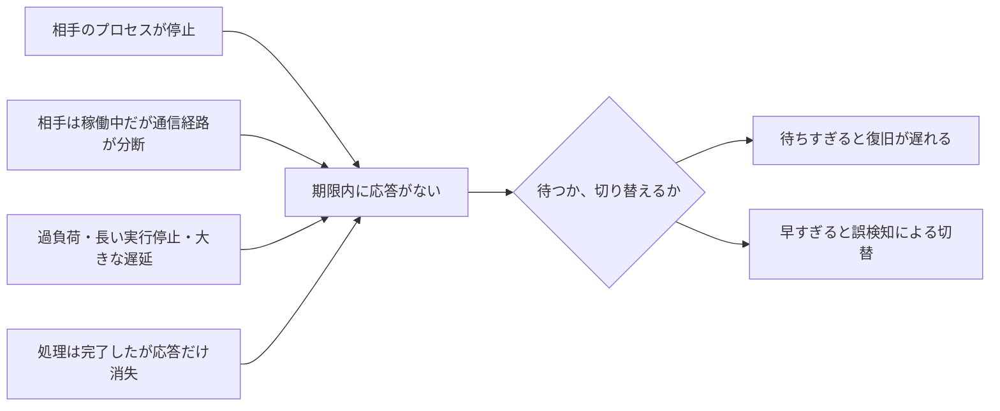
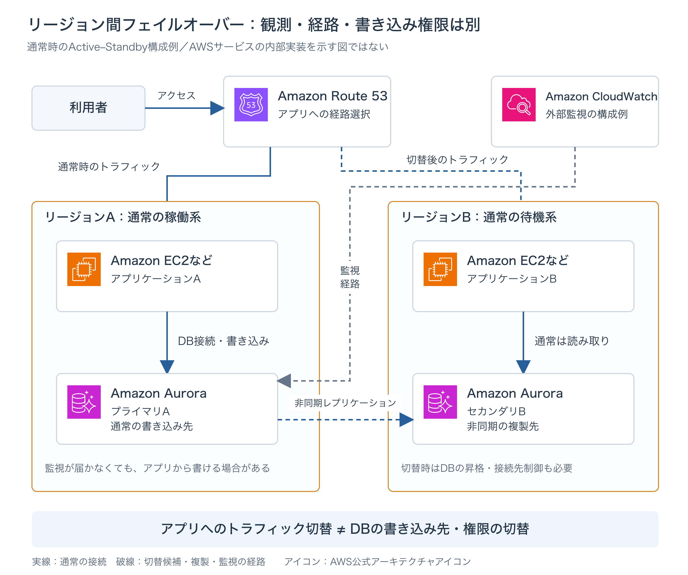
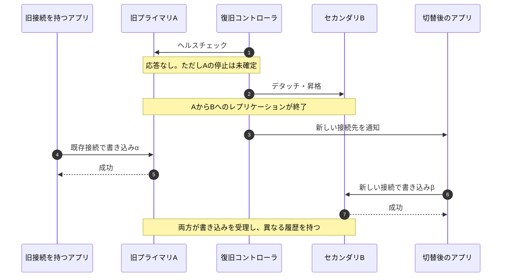
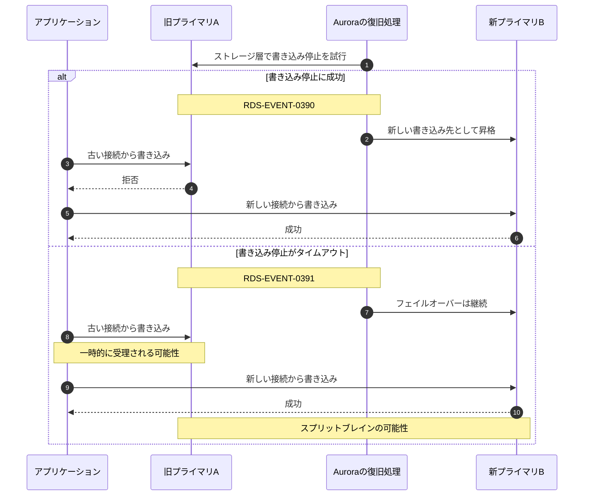
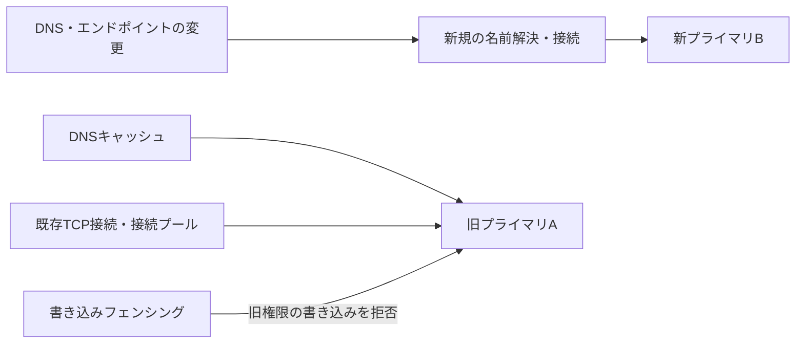
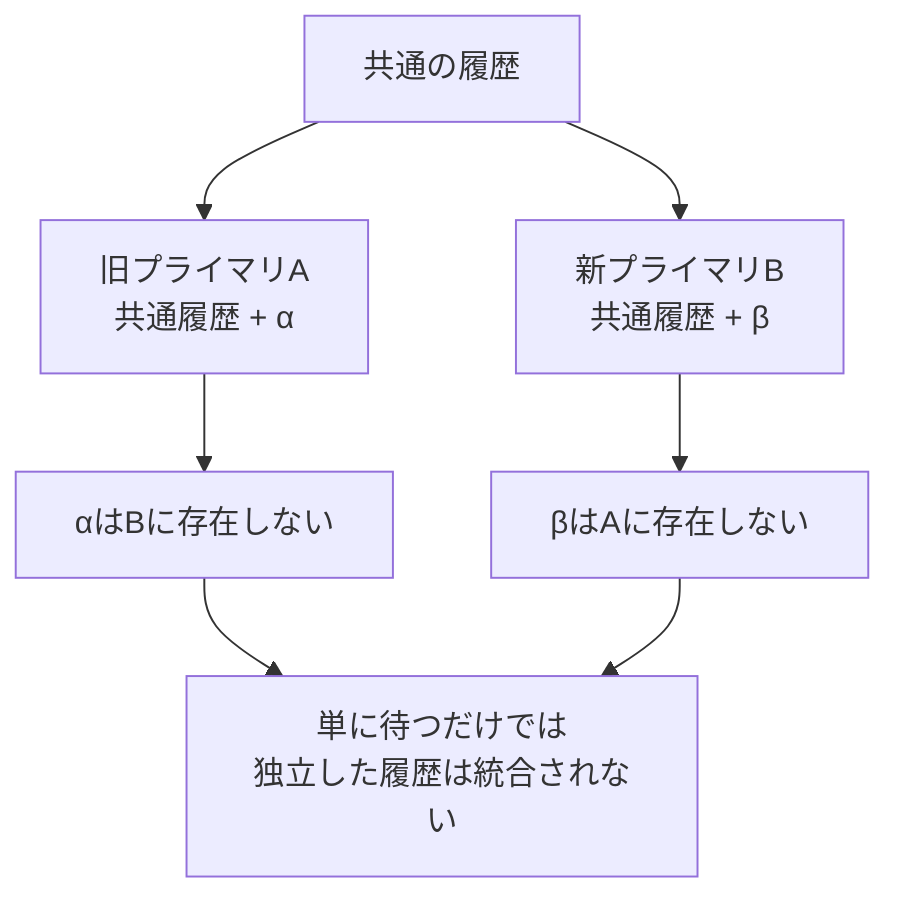
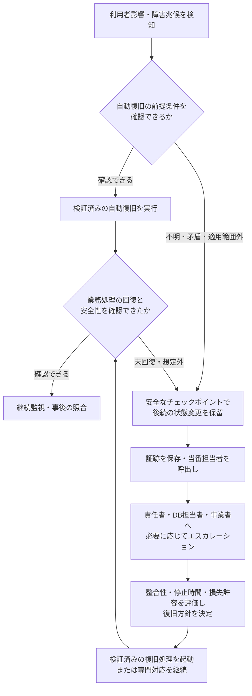

# リージョン間Active–Standbyフェイルオーバーの設計と運用

## 要旨：自動化には、適用範囲と人への引継ぎまで含める

**リージョン間フェイルオーバーの難しさは、不完全な観測に基づいて、書き込み権限・データ・接続先を変更しなければならない点にある。** タイムアウトだけでは旧プライマリの停止を証明できず、昇格やDNS変更の成功だけでは業務の復旧を保証できない。

このため、設計すべき対象は切替スクリプトだけではない。正常に処理できる条件と、条件が不明になった場合の保留・調査・エスカレーションを一つの復旧経路として定義する必要がある。これは、以下の技術的制約と公開事例から導く本レポートの結論である。

| 復旧で満たす条件 | 自動化で確認・実行すること | 不明・想定外の場合に残る判断 |
|---|---|---|
| 利用者への影響を把握する | 複数の観測点と業務処理の成否を確認する | 監視と利用者の状態が食い違う理由を調べる |
| 競合する書き込みを防ぐ | リーダー選出・権限管理・フェンシングを適用する | 旧プライマリが書ける場合の継続・停止方針を決める |
| 許容できるデータで再開する | 複製状況と復旧時点を確認する | 未複製データや競合更新の扱いを決める |
| 業務として回復する | 接続先・依存サービス・容量を検証する | 途中失敗からの復旧や専門家への引継ぎを行う |

本レポートは、主に単一ライターのデータ整合性を重視するシステムを対象とする。自動化を毎回人が承認することを一律に求めるものではなく、無人で処理できる範囲と、そこから外れた場合の運用を明確にする。公開情報の確認日：2026年11月21日。

## 1. 出発点：無応答は停止の証拠にならない

### 1.1 同じタイムアウトに、異なる原因が隠れる

**タイムアウトが示すのは「この観測点から期限内に応答を得られなかった」という事実である。**

書き込みの場合、応答がなくても処理が完了している可能性がある。したがって復旧や再試行には、実行結果の確認や冪等性も必要になる。[1][2]

ここでは、検知器が「障害あり」と判断することを「陽性」と呼ぶ。

| 利用者の処理 | 検知器の判断 | 切替への影響 |
|---|---|---|
| 成功している | 正常 | 真陰性 |
| 成功している | 障害あり | **偽陽性：不要な切替を起こし得る** |
| 失敗している | 正常 | **偽陰性：必要な復旧が始まらない** |
| 失敗している | 障害あり | 真陽性 |

タイムアウトを短くすれば検知は速くなるが、遅延を故障と疑いやすい。長くすれば逆になる。失敗検知器の研究は、この問題を完全性・正確性などの性質で整理している。[1]

### 1.2 監視と利用者では、見ている経路・処理が違う

以下は概念構成であり、AWSの内部実装を表すものではない。EC2アプリケーションとCloudWatchを利用した外部監視は構成例である。

| 観測のずれ | 起こり得る状態 |
|---|---|
| 監視経路だけが障害 | 監視は無応答でも、アプリケーションは旧プライマリに書き込める |
| ハートビートだけが正常 | 監視は正常と判断しても、実際のクエリ処理は失敗している |
| 一部経路・利用者だけが障害 | ある利用者には正常で、別の利用者には障害に見える |

Gray Failureの論文は、利用者が障害を受けているのにシステム側の観測者が正常と判断する差を、**differential observability（観測の差）**として扱う。[3]

この観測の限界は、人が判断しても消えない。必要なのは「人なら停止を確実に見抜ける」という前提ではなく、不確実なままでも守る条件と、追加の確認・判断を行う経路である。

### 1.3 理論的な限界は、自動化の否定ではない

| 文献 | 設計への示唆 |
|---|---|
| 失敗検知器の研究 | 誤った疑いが起こり得ることを前提に、プロトコルを設計する。[1] |
| FLP | 完全非同期で1プロセスがクラッシュし得るモデルでは、決定的な合意プロトコルは全実行での終了を保証できない。[14] |
| 部分同期・Raft | 安全性と進行性を分け、必要な通信・時間・クォーラムの条件の下で進行させる。[15][16] |

**FLPを「自動フェイルオーバーは不可能」と解釈してはいけない。** 実用上は、誤検知があっても競合する更新を確定させない仕組みと、前提が満たされない間の振る舞いを決める。

## 2. 切替の核心：昇格と、旧ライターの排除は別である

### 2.1 手動デタッチで生じる危険な状態

Aurora Global Databaseからセカンダリをデタッチすると、そのクラスタは同期対象から外れ、独立した読み書き可能なクラスタになる。[4]

以下は旧プライマリへの書き込みが続く概念例であり、AWSの推奨手順ではない。

**デタッチは、新しいライターを作っても、旧ライターの停止を意味しない。** AWSの手動フェイルオーバー手順は、旧プライマリへの書き込み停止から始まる。[5]

### 2.2 マネージド処理でも、保証範囲を確認する

フェンシングは、旧所有者が生存していても、古い権限による操作を保護対象に拒否させる仕組みである。リーダー選出だけでは、そのリーダーが行う外部への副作用まで必ず制御できるとは限らない。[2]

Auroraはマネージドフェイルオーバー時、旧プライマリの書き込みをストレージ層で止めようとする。ただしAWSはベストエフォートと説明し、一時的なスプリットブレインの可能性を明記している。[5]

図は公開仕様に基づく概念図であり、AWS内部の厳密な処理順序やイベント通知元を示していない。

| RDSイベント | 意味 | 運用で区別する状態 |
|---|---|---|
| `RDS-EVENT-0390` | 書き込みブロックに成功 | 旧権限の書き込み停止を確認できた |
| `RDS-EVENT-0391` | 書き込みブロックがタイムアウト。処理は継続 | 停止成功とみなさず、双方の状態を確認する |
| `RDS-EVENT-0397` | グローバルライターエンドポイントのDNS変更完了 | 経路の更新であり、フェンシング成功とは別 |

イベントの意味はAWS仕様、右列はその意味から導く運用上の整理である。[6]

**自社の自動化を保留しても、既に起動したAurora側の処理が止まるとは限らない。** タイムアウト後の手順には、何が完了し、どこが書き込み可能かを確認する観測手段が必要になる。

### 2.3 DNS変更は、書き込み権限の制御を代替しない

グローバルライターエンドポイントを使っても、DNSキャッシュや既存接続は個別に考慮する必要がある。AWSは、そのエンドポイントにもスプリットブレイン対策が必要と説明している。[7][8]

短いTTLや接続プールの再作成は移行を速めるが、それだけで旧ライターへの書き込みを排除できるわけではない。**障害検知・昇格・フェンシング・経路移行を、それぞれの成立条件で確認する。**

## 3. 昇格後にも残る仕事：データと業務の復旧

### 3.1 未複製データの欠落と、履歴の分岐を区別する

α・βは説明用の書き込みであり、実際の事故のトランザクションではない。

| 問題 | 必要になる対応 |
|---|---|
| Aで成功した書き込みがBに届いていない | 復旧時点と欠落範囲の評価、残存データの保全 |
| AとBがそれぞれ新しい書き込みを受理した | 正とする履歴の決定、競合更新の照合・業務上の修復 |

各DBが内部的にトランザクション整合性を保っていても、両者の内容が一致するとは限らない。マネージド復旧は旧リージョンの再構築前にスナップショット取得を試みるが、競合した業務データを自動マージするものではない。[5]

### 3.2 DBの復旧と、サービス全体の復旧は一致しない

アプリケーションの接続先が正しくても、認証、キュー、ストレージ、容量、構成、復旧用APIのいずれかが利用できなければ、業務は回復しない。AWSも依存関係に応じた切替戦略、待機系の準備、定期試験を求めている。[9]

したがって、自動化の終了条件を「昇格APIが成功した」に置くのは不十分である。業務上の読み書き、依存サービス、データの状態まで確認し、未回復なら調査・引継ぎへ進む設計が必要になる。次の公開事例は、その必要性を異なる角度から示している。

## 4. 公開事例が示す、自動化と人の対応の境界

| 事例 | 何が自動化・冗長化の前提を外れたか | 実施された対応と、設計への教訓 |
|---|---|---|
| **GitHub：2018年10月21日** [12] | 43秒の分断でMySQLが拠点間自動切替。双方に相手側にない更新が残り、安全な即時切戻しができなかった | インシデント責任者とDB専門家を招集。変更を制限し、データ保全を優先した復旧を判断。**自動切替の成功後にも、履歴と業務をどう回復するかの判断が残る。** |
| **Google Cloud：2019年6月2日** [19] | 保守自動化の不具合などで複数拠点のネットワーク制御系が停止し、復旧ツールも混雑の影響を受けた | 原因の自動化を停止し、代替手段を使って制御系を復旧。**自動化・監視・通常の操作経路も同時に使えなくなる場合を想定する。** |
| **Cloudflare：2023年11月2日** [20] | 冗長化されたサービスに障害拠点への依存が残り、拠点全体の停止試験も未実施だった | DR環境の手動設定や構成管理サーバーからの再立上げが必要になった。**部品単位の切替成功は、復旧経路全体の成立を保証しない。** |
| **GitLab：2016年7月12日** [11] | 切替通知不足と不適切な復旧手順で状態を誤認。人手対応中にHA制御を止めてもDBは動き続けた | 約30分のスプリットブレインが発生し、破棄したDBへの書き込みを失った。**人への引継ぎも、正確な状態把握・検証済み手順がなければ事故を増幅する。** |

これらはすべてが狭義のグレー障害やクラウドのリージョン切替事故というわけではない。共通点は、**既定の回復経路が扱えない状態に入り、判断・操作・連絡の別経路が必要になったこと**である。表の太字は、各報告から導く設計上の教訓を示す。

GitHubは、双方にしかない更新を明記しているが、長時間の同時書き込みまでは報告だけから断定しない。また、AuroraについてはAWSが可能性を明記している一方、今回の調査では確証を持って引用できる事故の詳細報告は特定していない。**確認された事例と、公式仕様上のリスクを区別する。** [5][12]

SREcon 2019の「Autopsy of a MySQL Automation Disaster」も、自動復旧・人手操作・復旧処理の特殊ケースが組み合わさったスプリットブレインとデータ破損の実例を扱っている。[13]

## 5. 自動化の適用範囲と、人に引き継ぐ条件を設計する

### 5.1 実行手順に加え、適用条件・完了条件・途中状態を定義する

前節の事例は、自動化をやめて手作業に戻す根拠にはならない。Google SREは、定型操作の一貫性という自動化の価値と、規模によっては手動運用が成立しないことを説明している。同時に、人の介入が避けられない場合も認めている。[18]

本レポートで提案する構成は、次のとおりである。

ここで「保留」とは、自社が制御する後続の昇格・再切替・再試行などを、安全なチェックポイントで抑止することである。実行中の処理を無条件に強制終了することではない。保留中のサービス状態と、新たに実行してよい操作も事前に定める。

| 自動化に定義するもの | 具体例 |
|---|---|
| 適用条件 | 対象障害、必要な観測、待機系の準備、許容する損失や停止 |
| 途中状態 | フェンシング済み・昇格済み・経路更新済みなどを別々に記録 |
| 完了条件 | 利用者の業務処理が回復し、権限・データ・接続の条件も満たす |
| 引継ぎ条件 | 観測の矛盾、確認不能、時間超過、途中失敗、再試行上限 |
| 再開条件 | 誰が何を確認すれば、どのチェックポイントから再実行できるか |

### 5.2 グレーな状態を、具体的な呼出し条件にする

以下は単一ライターの整合性を重視した設計例であり、製品共通の仕様や一律の停止ルールではない。

| 引継ぎの契機 | 自動化側で残す情報・制御 | 人が担う判断・対応 |
|---|---|---|
| 監視と利用者の成功率が矛盾 | 観測点、失敗処理、時刻、直近変更を記録 | 追加調査し、障害の範囲を評価 |
| 旧ライターの停止を確認できない | 双方の役割とフェンシング結果を記録 | 書き込み継続・制限・停止の方針を判断 |
| 複製遅延が不明・許容範囲外 | 最終確認時刻と複製状況を保全 | 損失許容の権限を持つ責任者が判断 |
| 切替が途中失敗・時間超過 | 完了した操作と結果、再実行可否を記録 | DB・基盤担当者や事業者と復旧を進める |
| 切替後も未回復・再切替を反復 | 再試行上限を適用し、証跡を保全 | 依存先や容量を含めて原因を調査 |
| 管理API・認証・監視も利用不能 | 事前準備した代替経路へ誘導 | 緊急アクセスや事業者連絡で操作経路を確保 |

不明な状態を安全側に扱う場合でも、停止時間は増え得る。整合性・可用性・データ損失のどれをどの条件で優先するかは、障害中に即興で決めず、業務責任を含む方針として合意しておく。

### 5.3 人の判断と、手作業での実行を分ける

AWSのリージョン切替ガイダンスは、操作を自動化し、発動判断は事前に定めた担当者が行うことを推奨する。[9] この運用では、人が損失や影響を評価した後、検証済みの処理を起動できる。

これは、すべての再起動やフェイルオーバーに人の承認を要求するものではない。自律復旧が適切な範囲では無人で進め、適用範囲外では人が引き取る。**必要なのは、全操作を人が手打ちする代替手順ではなく、判断と実行を制御できる引継ぎ経路である。**

## 6. 引継ぎを実際に機能させるための運用要件

### 6.1 「連絡先がある」から「復旧を指揮できる」へ

Googleのインシデント管理は、指揮系統、明確な役割、作業記録、早期の宣言を重視する。[21] フェイルオーバーでも、次の役割と権限を運用に落とし込む。

| 役割 | あらかじめ決めること |
|---|---|
| 当番担当者 | 呼出しの受領、初動の確認、記録、専門家への連絡 |
| インシデント責任者 | 対応方針と作業の統制、優先順位、継続・中止の判断 |
| DB・基盤担当者 | 書き込み権限、複製状態、接続先、途中状態の評価 |
| 業務上の判断権限者 | 許容損失や書き込み停止を、事前方針に沿って判断 |
| クラウド事業者など | 自社から確認・操作できない内部状態や障害への対応 |

組織によって複数の役割を同じ人が担ってもよい。必要なのは、誰が引き取り、無応答なら誰に上げるか、操作権限がどこにあるかが曖昧にならないことである。

### 6.2 復旧経路も障害対象として試験する

Google SREは、自動化が進むにつれ担当者の操作経験や実際の介入能力が失われ、「最後は手動でできる」という前提が成立しなくなる危険を指摘する。[18] GitLabの事例も、人手対応の存在だけでは安全性が高まらないことを示す。[11]

| 訓練・試験の対象 | 確認すること |
|---|---|
| 自動復旧の正常系 | 事前条件を満たした場合、業務の回復まで到達するか |
| 誤検知・グレー障害 | 自動化が適用範囲外を検出し、必要な情報とともに引き継げるか |
| 途中失敗・再実行 | 二重昇格や重複した副作用を避けて再開できるか |
| 依存先を含む拠点停止 | 認証、監視、構成管理、容量などの隠れた依存がないか |
| 通常の操作経路の喪失 | 代替アクセス、緊急権限、連絡手段が本当に使えるか |
| 当番・責任者の不在 | 代替担当者へ連絡でき、判断権限を引き継げるか |
| データ照合・切戻し | 欠落・分岐を評価し、安全に再構築・切戻しできるか |

復旧時の制御APIが障害に巻き込まれる可能性にも備える。AWS ARCは、復旧時に高可用なデータプレーン操作を利用できるよう事前準備することを推奨している。[10]

これらは全シナリオの安全性を証明する試験ではない。少なくとも、通常の切替成功だけでは見えない運用上の前提を確認するための試験である。

## 7. 設計の完了条件

**自動フェイルオーバーは、人が不要になることではなく、定義された範囲の障害を、人の即時判断なしでも回復できる能力である。** 範囲外の状態については、保留・観測・エスカレーション・復旧を一続きで設計する。

その完了条件は、次の問いに答え、訓練で確認できることである。

1. 無応答や観測の矛盾があっても、競合書き込みをどう防ぐか。
2. 昇格成功に加えて、どの業務処理をもって回復と判定するか。
3. 何が不明になったら、どこまで進め、どこで後続操作を保留するか。
4. 誰が何を見て引き取り、通常ツールが使えない場合はどう対応するか。
5. 判断・招集・データ照合の時間も含め、復旧目標を満たせるか。

**自動化と手動手順は、別々の付属物ではない。同じ状態遷移・同じ証跡・同じ復旧目標を共有する一つの運用設計である。**

## 参考資料

1. [Chandra・Toueg：Unreliable Failure Detectors for Reliable Distributed Systems](https://ecommons.cornell.edu/entities/publication/7948ff49-7263-49f8-a29b-d062e7cbb240)
2. [AWS Builders’ Library：Leader election in distributed systems](https://d1.awsstatic.com/builderslibrary/pdfs/leader-election-in-distributed-systems.pdf)
3. [Huangほか：Gray Failure: The Achilles’ Heel of Cloud-Scale Systems](https://www.microsoft.com/en-us/research/wp-content/uploads/2017/06/paper-1.pdf)
4. [AWS：Removing a cluster from an Amazon Aurora global database](https://docs.aws.amazon.com/AmazonRDS/latest/AuroraUserGuide/aurora-global-database-detaching.html)
5. [AWS：Using switchover or failover in Amazon Aurora Global Database](https://docs.aws.amazon.com/AmazonRDS/latest/AuroraUserGuide/aurora-global-database-disaster-recovery.html)
6. [AWS：Amazon RDS event categories and event messages for Aurora](https://docs.aws.amazon.com/AmazonRDS/latest/AuroraUserGuide/USER_Events.Messages.html)
7. [AWS：Connecting to Amazon Aurora Global Database](https://docs.aws.amazon.com/AmazonRDS/latest/AuroraUserGuide/aurora-global-database-connecting.html)
8. [AWS：Best practices for routing control in ARC](https://docs.aws.amazon.com/r53recovery/latest/dg/route53-arc-best-practices.regional.html)
9. [AWS：Multi-Region fundamental 4: Operational readiness](https://docs.aws.amazon.com/prescriptive-guidance/latest/aws-multi-region-fundamentals/fundamental-4.html)
10. [AWS：Data and control planes for routing control](https://docs.aws.amazon.com/r53recovery/latest/dg/data-and-control-planes.html)
11. [GitLab：Postgres DB Split brain incident led to data loss — postmortem](https://gitlab.com/gitlab-com/gl-infra/production/-/issues/48)
12. [GitHub：October 21 post-incident analysis](https://github.blog/news-insights/company-news/oct21-post-incident-analysis/)
13. [USENIX SREcon 2019：Autopsy of a MySQL Automation Disaster](https://www.usenix.org/conference/srecon19emea/presentation/gagne)
14. [Fischer・Lynch・Paterson：Impossibility of Distributed Consensus with One Faulty Process](https://www.cs.cornell.edu/courses/cs5414/2017fa/papers/fischer.pdf)
15. [Dwork・Lynch・Stockmeyer：Consensus in the Presence of Partial Synchrony](https://dspace.mit.edu/entities/publication/108bf327-aff6-414b-a48f-b357a821c48e)
16. [Ongaro・Ousterhout：In Search of an Understandable Consensus Algorithm](https://raft.github.io/raft.pdf)
17. [AWS公式アーキテクチャアイコン](https://aws.amazon.com/jp/architecture/icons/)
18. [Google SRE：The Evolution of Automation at Google](https://sre.google/sre-book/automation-at-google/)
19. [Google Cloud：Networking Incident #19009（2019年6月2日）](https://status.cloud.google.com/incident/cloud-networking/19009)
20. [Cloudflare：Post mortem on the Cloudflare Control Plane and Analytics Outage（2023年11月2日）](https://blog.cloudflare.com/post-mortem-on-cloudflare-control-plane-and-analytics-outage/)
21. [Google SRE Workbook：Incident Response](https://sre.google/workbook/incident-response/)

### 図の形式について

アーキテクチャ図はAWS公式アイコンを使用したPNG画像として埋め込んだ。Markdownを移動・共有する場合は、同じ階層の`images`フォルダも一緒に扱う。その他の6つの図はMermaid形式で保持しており、対応するMarkdownビューアで表示できる。
