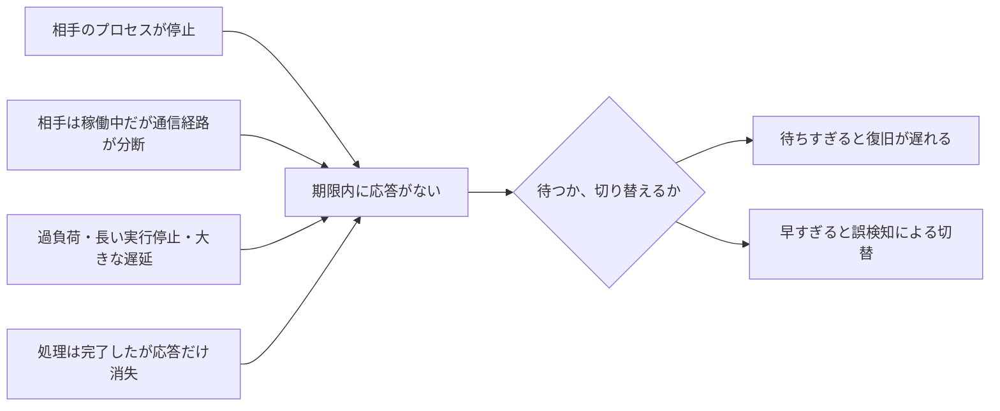
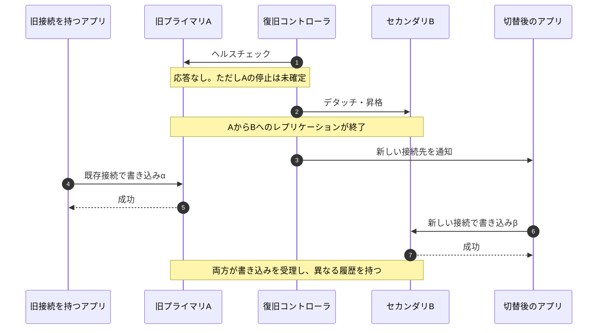
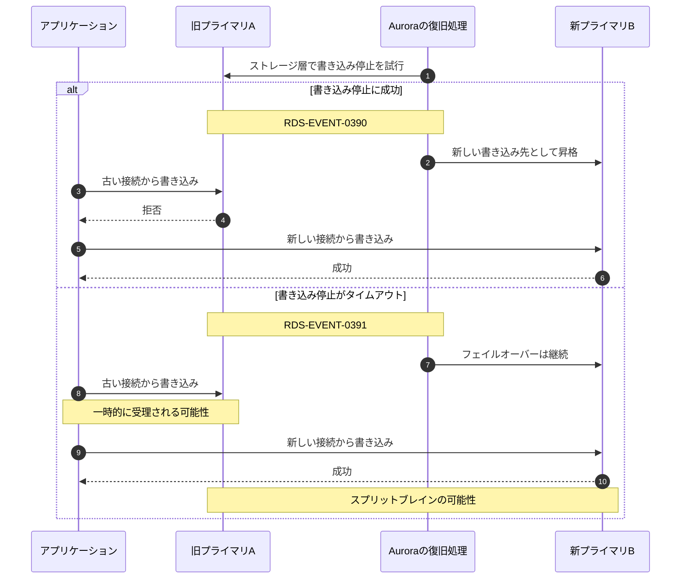
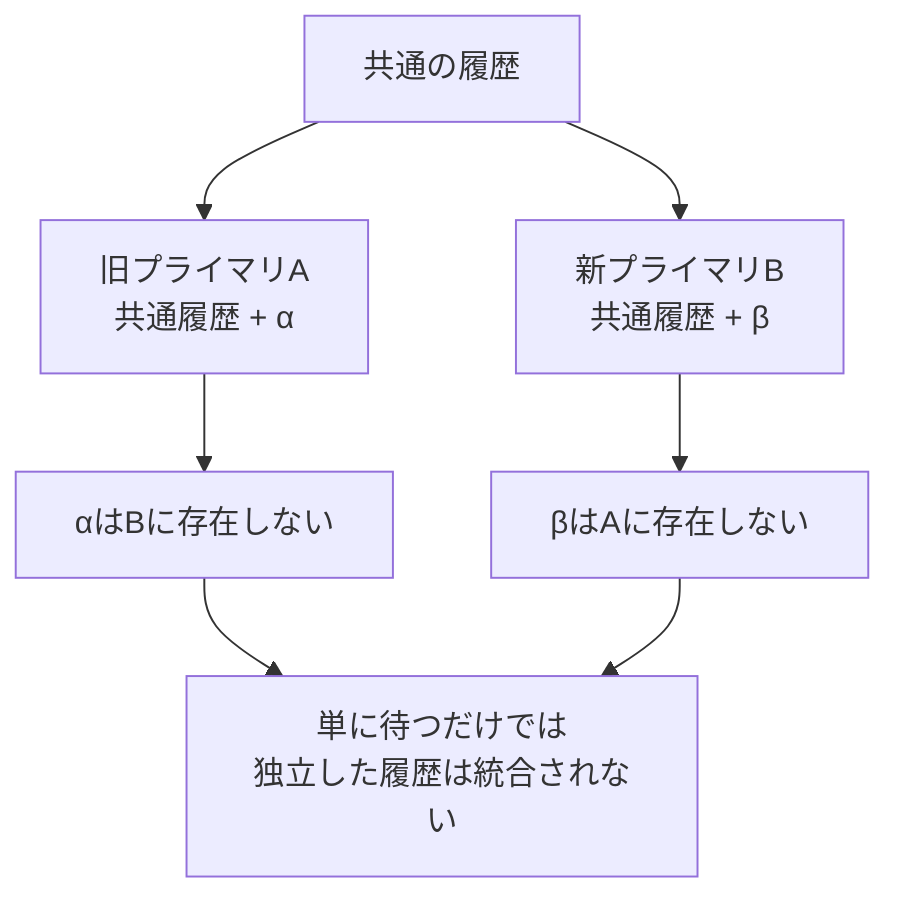
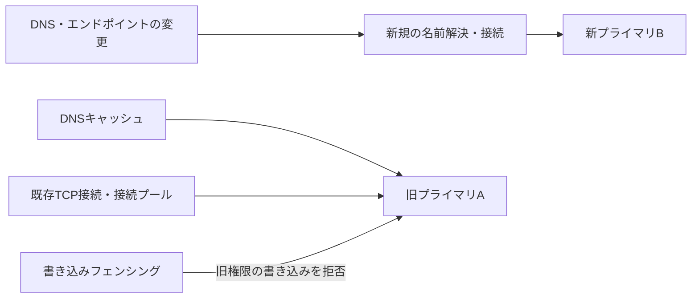
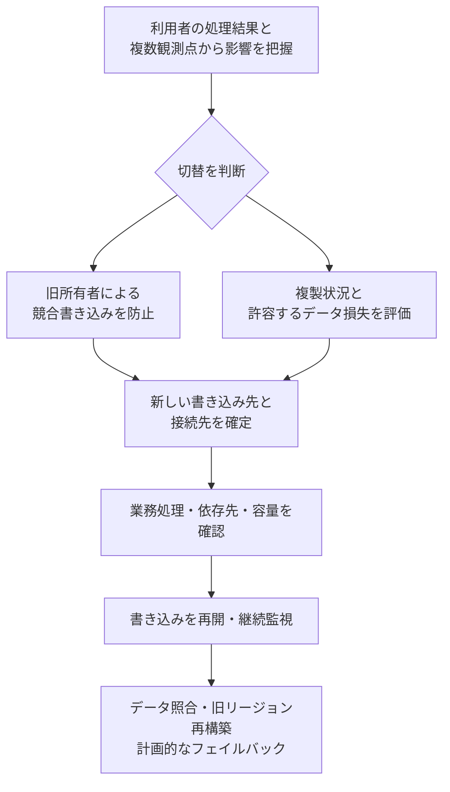

# リージョン間Active–Standbyフェイルオーバーが難しい理由

このセッションのまとめ。公開情報の確認日：2026年11月21日。

## 結論

**タイムアウトは「相手が停止した証拠」ではなく、「この観測点から期限内に応答を得られなかった」という情報である。**

安全なフェイルオーバーには、次の3つを別々に扱う必要がある。

| 判断・制御の対象 | 確認すること |
|---|---|
| 障害の観測 | 誰から、どの経路で、どの処理が失敗しているか |
| 書き込み権限 | 旧プライマリが動き続けても、競合する書き込みを防げるか |
| データと接続の移行 | 新プライマリに何が届いており、クライアントが実際にどこへ接続しているか |

**「障害を検知した」「スタンバイを昇格した」「DNSを切り替えた」は、それぞれ異なる状態である。**

## 1. 無応答だけでは、停止と遅延・分断を区別できない

特に書き込みでは、応答がないことから「処理されなかった」とも断定できない。再試行や復旧処理では、処理結果の照会や冪等性も必要になる。[1][2]

ここでは、検知器が「障害あり」と判断することを「陽性」と呼ぶ。

| 利用者の処理 | 検知器の判断 | 結果 |
|---|---|---|
| 成功している | 正常 | 真陰性 |
| 成功している | 障害あり | **偽陽性：不要な切替を起こす可能性** |
| 失敗している | 正常 | **偽陰性：必要な切替が始まらない可能性** |
| 失敗している | 障害あり | 真陽性 |

タイムアウトを短くすると検知は速くなる一方、遅延を障害と疑いやすくなる。長くすると、その逆になる。失敗検知器の研究では、故障したプロセスを疑える性質と、正常なプロセスを誤って疑わない性質を区別する。[1]

## 2. 監視の正常と、利用者から見た正常は一致しない

以下は概念構成であり、特定サービスの内部実装を示すものではない。EC2アプリケーションとCloudWatchを使った外部監視は構成例である。

**アプリケーションへのトラフィック切替と、DBの書き込み先・権限の切替は別である。**

| 観測のずれ | 起こり得る状態 |
|---|---|
| 監視経路だけが障害 | 監視からは無応答だが、アプリケーションは旧プライマリに書き込める |
| ハートビートだけが正常 | 監視は正常と判断するが、実際のクエリ処理は失敗している |
| 一部の経路・利用者だけが障害 | ある利用者には正常で、別の利用者には障害に見える |

このような観測主体間の差を、Gray Failureの論文は **differential observability（観測の差）** として扱っている。ハートビートの成功だけでは、利用者の処理成功を保証できない。[3]

## 3. 手動デタッチによる昇格で、旧プライマリが稼働し続ける場合

Aurora Global Databaseからセカンダリをデタッチすると、そのクラスタは同期対象から外れ、独立した読み書き可能なクラスタになる。[4]

次の図は、このセッションで検討した**危険な状態の概念例**である。AWSの推奨手順を表すものではない。

この状態が**スプリットブレイン**である。デタッチ自体を「旧プライマリの書き込み停止」とみなしてはいけない。AWSの手動フェイルオーバー手順は、旧プライマリへの書き込み停止から始まる。[5]

## 4. Auroraのマネージドフェイルオーバーにも、フェンシングの限界がある

**フェンシング**とは、旧所有者が生存していても、保護対象への古い権限による操作を拒否する仕組みである。[2]

Auroraのマネージドフェイルオーバーは、旧プライマリへの書き込みをストレージ層で止めようとする。ただしAWSはベストエフォートと説明しており、停止が間に合わない場合の一時的なスプリットブレインを明記している。[5]

図は公開仕様に基づく概念図であり、AWS内部の厳密な処理順序やイベント通知元を示していない。

| RDSイベント | 公開されている意味 |
|---|---|
| `RDS-EVENT-0390` | ストレージ層での書き込みブロックに成功 |
| `RDS-EVENT-0391` | 書き込みブロックがタイムアウト。処理は継続 |
| `RDS-EVENT-0397` | グローバルライターエンドポイントのDNS変更が完了 |

**DNS変更の完了と、旧プライマリの書き込み停止成功は、別のイベントである。** [6]

## 5. レプリケーション遅延による欠落と、履歴の分岐は違う

以下のα・βは説明用の書き込みであり、実測値や実際の事故のトランザクションではない。

| 問題 | 内容 |
|---|---|
| 未複製データの欠落 | Aで成功済みの書き込みが、昇格時点のBに届いていない |
| 履歴の分岐 | AとBがそれぞれ新しい書き込みを受け付け、双方にしかない更新が生じる |

個々のDBが内部的にトランザクション整合性を保っていても、両者の内容が一致するとは限らない。

マネージド復旧では、旧リージョンを新プライマリから再構築し、その前に旧ストレージのスナップショット取得を試みる。**競合した業務データを自動マージする仕組みではない。** [5]

## 6. DNS切替だけでは、クライアントは一斉に移動しない

グローバルライターエンドポイントは、マネージド切替に合わせて接続先を更新する。しかし、アプリケーション側のDNSキャッシュや既存接続は別途考慮が必要である。AWSは、このエンドポイントを使う場合にもスプリットブレイン対策が必要と説明している。[7][8]

**短いTTLや接続の再作成は移行を速める対策であり、単独で排他的な書き込み権限を保証するものではない。**

## 7. 復旧設計で分けて確認すること

これは安全性を重視した設計上の整理であり、全製品に共通する実装手順ではない。緊急復旧時に停止やデータ損失を許容する場合も、その判断を明示する必要がある。

| 設計上の論点 | 学んだこと |
|---|---|
| 検知と切替判断 | 「無応答」を「停止確定」に置き換えない |
| リーダー選出と操作権限 | 選出だけで満足せず、旧所有者の副作用を防ぐ |
| クォーラム・リース | 成立条件や時間の仮定を理解する。第三の投票者も、未複製データは復元しない |
| データ損失 | RPO（許容するデータ損失の目標）と復旧時点を区別して確認する |
| 経路の移行 | アプリ向けDNS、DBエンドポイント、プロキシ、接続プールを個別に確認する |
| 復旧処理の依存先 | 障害中でも使える仕組みを事前に用意する。ARCは復旧時のデータプレーン利用を推奨している |
| 構成・容量 | DBだけでなく、認証・キュー・ストレージなどの依存先や待機系の容量も確認する |
| 運用 | 通常時から切替・切戻しを繰り返し、手順と構成のずれを見つける |

AWSのマルチリージョン運用ガイダンスは、**切替操作を自動化し、発動判断は人が行う**ことを推奨している。これは運用上の推奨であり、自動切替が理論的に不可能という意味ではない。人が判断しても、通信の不確実性やフェンシングの問題そのものは残る。[2][9][10]

## 8. 公開されている実際の障害事例

| 事例 | 公開情報で確認できること | この議論との関係 |
|---|---|---|
| **GitLab：2016年7月12日** | 通信断でDBが切り替わり、その後の人手復旧でHA制御を止めてもDBは動作したままだった。約30分、両DBがプライマリとして稼働。最終的に破棄したDBへの書き込みが失われた | **両方のDBにクライアントが接続していた直接的な事例** |
| **GitHub：2018年10月21日** | 43秒のネットワーク分断でMySQLが東海岸から西海岸に自動切替。両拠点に相手側にない書き込みが残り、即時の安全な切戻しができなかった。関連するサービス劣化は24時間11分 | **自動切替後にデータ履歴が分岐した事例** |
| **SREcon 2019のMySQL事例** | 自動復旧、人手操作、復旧処理の特殊ケースが重なり、スプリットブレインとデータ破損が発生した実例を講演で紹介 | **自動化と復旧経路の組合せによる事故** |
| **Aurora Global Database** | AWSがベストエフォートのフェンシングと一時的なスプリットブレインの可能性を明記 | **公式に説明されたリスク。今回の調査では、確証を持って引用できるAurora事故の詳細報告は特定していない** |

GitHubの報告は、双方にしか存在しない更新を明確に説明している。一方、長時間にわたり両方へ同時に書き続けていたことまでは、この報告だけから断定しない。報告時点では、一部書き込みの照合が継続中とされていた。[11][12][13]

## 9. 分散システム理論との対応

| 文献 | この議論での意味 |
|---|---|
| **Unreliable Failure Detectors for Reliable Distributed Systems** | 障害検知の不確実性を、完全性・正確性などの性質で整理する。[1] |
| **FLP：Impossibility of Distributed Consensus with One Faulty Process** | 完全非同期で1プロセスがクラッシュし得るモデルでは、決定的な合意プロトコルは全実行での終了を保証できない。[14] |
| **Consensus in the Presence of Partial Synchrony** | 通信・処理時間に関する仮定を導入し、実用的な合意と理論的限界をつなぐ。[15] |
| **Raft** | 安全性と進行性を分ける。遅延や選挙のやり直しで可用性が下がっても、合意済み履歴の安全性を保つ設計を示す。[16] |
| **Gray Failure** | 監視と利用者が異なる状態を観測し、従来の障害検知や復旧が作動しない問題を扱う。[3] |

**FLPを「自動フェイルオーバーは不可能」と解釈しない。** 実用システムは前提条件を設け、条件が満たされない場合に、安全性を守るため進行を止めるなどの選択を行う。

## 参考資料

1. [Chandra・Toueg：Unreliable Failure Detectors for Reliable Distributed Systems](https://ecommons.cornell.edu/entities/publication/7948ff49-7263-49f8-a29b-d062e7cbb240)
2. [AWS Builders’ Library：Leader election in distributed systems](https://d1.awsstatic.com/builderslibrary/pdfs/leader-election-in-distributed-systems.pdf)
3. [Huangほか：Gray Failure: The Achilles’ Heel of Cloud-Scale Systems](https://www.microsoft.com/en-us/research/wp-content/uploads/2017/06/paper-1.pdf)
4. [AWS：Removing a cluster from an Amazon Aurora global database](https://docs.aws.amazon.com/AmazonRDS/latest/AuroraUserGuide/aurora-global-database-detaching.html)
5. [AWS：Using switchover or failover in Amazon Aurora Global Database](https://docs.aws.amazon.com/AmazonRDS/latest/AuroraUserGuide/aurora-global-database-disaster-recovery.html)
6. [AWS：Amazon RDS event categories and event messages for Aurora](https://docs.aws.amazon.com/AmazonRDS/latest/AuroraUserGuide/USER_Events.Messages.html)
7. [AWS：Connecting to Amazon Aurora Global Database](https://docs.aws.amazon.com/AmazonRDS/latest/AuroraUserGuide/aurora-global-database-connecting.html)
8. [AWS：Best practices for routing control in ARC](https://docs.aws.amazon.com/r53recovery/latest/dg/route53-arc-best-practices.regional.html)
9. [AWS：Multi-Region fundamental 4: Operational readiness](https://docs.aws.amazon.com/prescriptive-guidance/latest/aws-multi-region-fundamentals/fundamental-4.html)
10. [AWS：Data and control planes for routing control](https://docs.aws.amazon.com/r53recovery/latest/dg/data-and-control-planes.html)
11. [GitLab：Postgres DB Split brain incident led to data loss — postmortem](https://gitlab.com/gitlab-com/gl-infra/production/-/issues/48)
12. [GitHub：October 21 post-incident analysis](https://github.blog/news-insights/company-news/oct21-post-incident-analysis/)
13. [USENIX SREcon 2019：Autopsy of a MySQL Automation Disaster](https://www.usenix.org/conference/srecon19emea/presentation/gagne)
14. [Fischer・Lynch・Paterson：Impossibility of Distributed Consensus with One Faulty Process](https://www.cs.cornell.edu/courses/cs5414/2017fa/papers/fischer.pdf)
15. [Dwork・Lynch・Stockmeyer：Consensus in the Presence of Partial Synchrony](https://dspace.mit.edu/entities/publication/108bf327-aff6-414b-a48f-b357a821c48e)
16. [Ongaro・Ousterhout：In Search of an Understandable Consensus Algorithm](https://raft.github.io/raft.pdf)
17. [AWS公式アーキテクチャアイコン](https://aws.amazon.com/jp/architecture/icons/)

### 図の形式について

アーキテクチャ図はAWS公式アイコンを使用したPNG画像として埋め込んだ。Markdownを移動・共有する場合は、同じ階層の`images`フォルダも一緒に扱う。その他の6つの図はMermaid形式で保持しており、対応するMarkdownビューアで表示できる。
