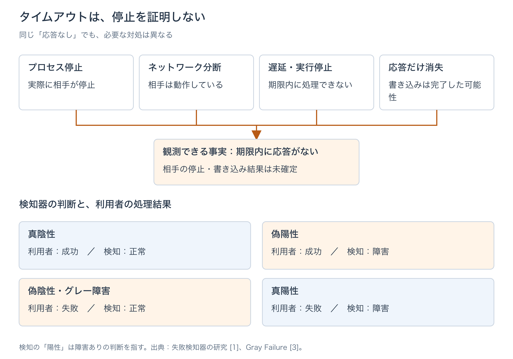
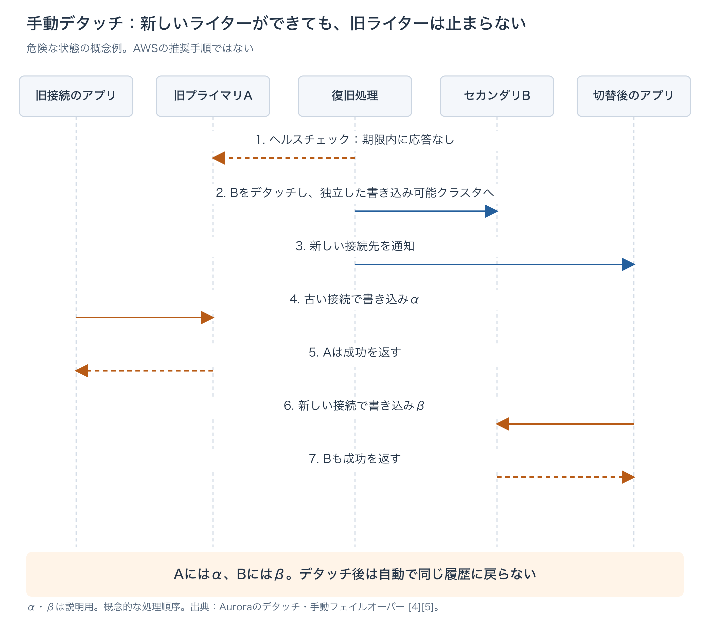
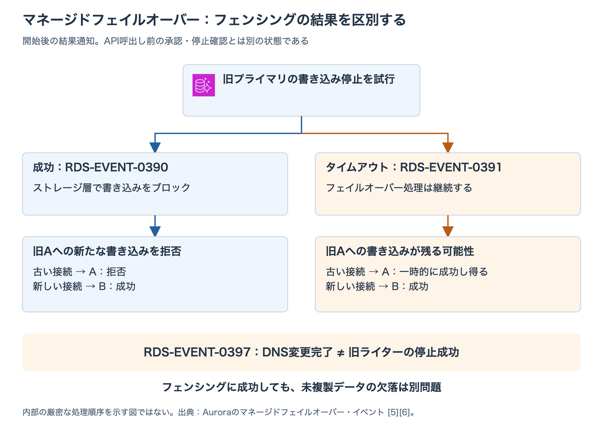
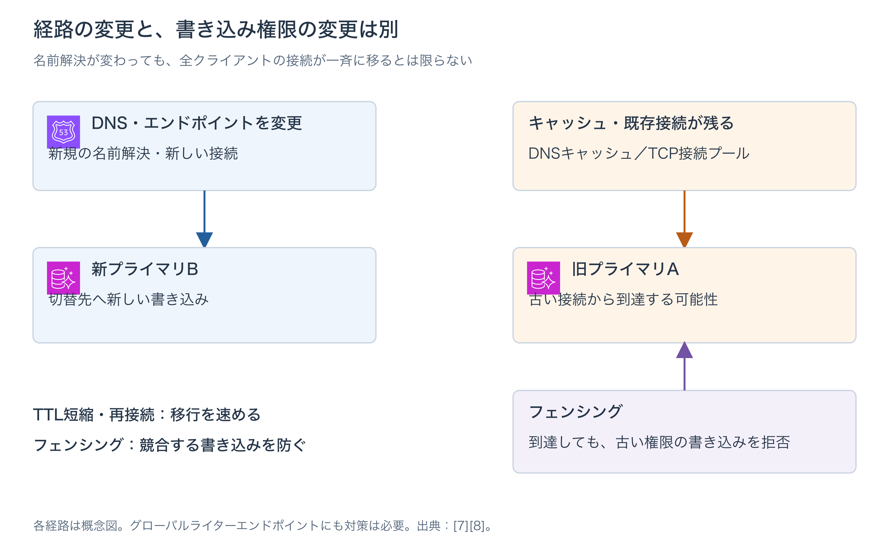
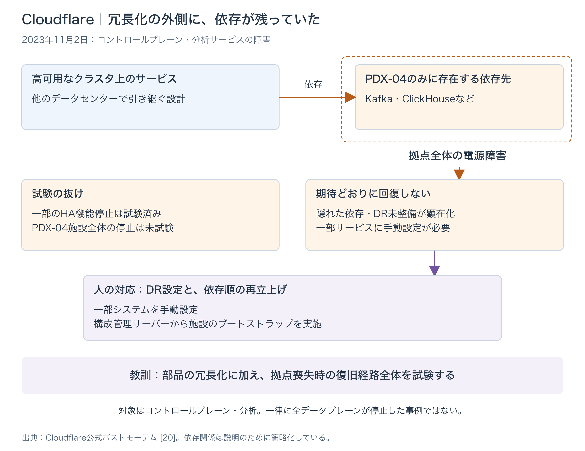
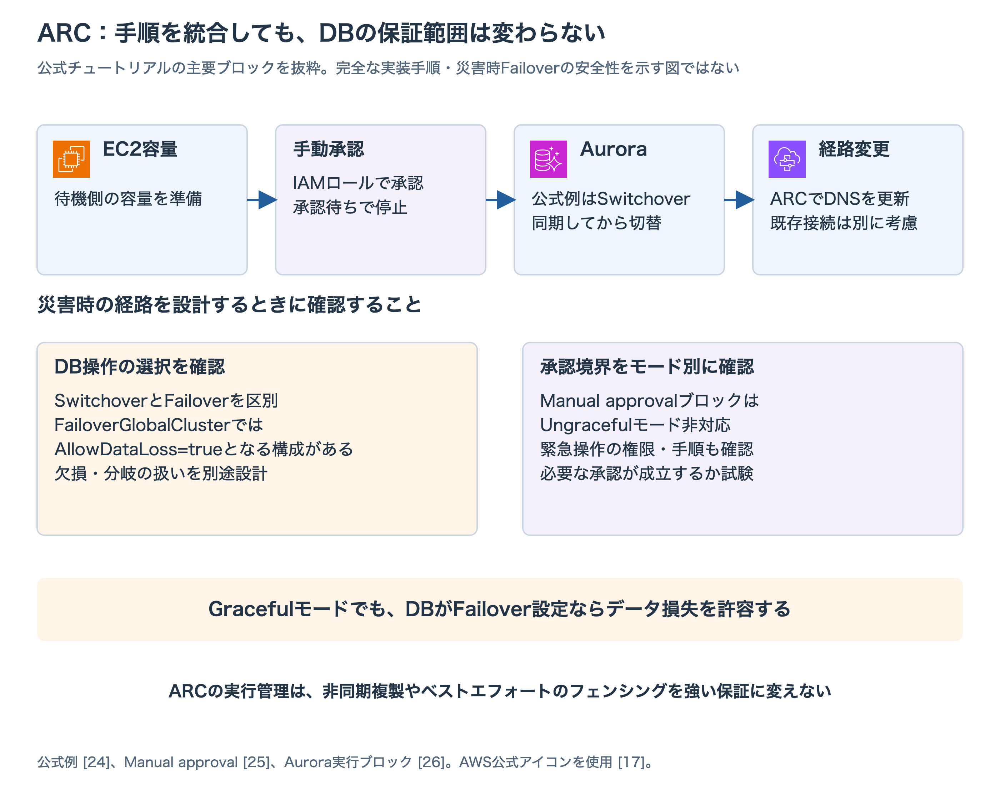

# リージョン間Active–Standbyフェイルオーバーの設計と運用

― Aurora Global Databaseを例に、開始判断・自動実行・例外対応を分ける ―

## 要旨：データ損失を伴う開始は人が判断し、切替手順は自動化する

**Aurora Global Databaseのように、非同期複製と旧ライターの排除に不確実性が残る構成では、「人が開始を判断し、検証済み手順を自動実行する」方式を基準案として評価する。** 障害の疑いから、データ損失を許容する昇格までを無人で直結する場合は、別途その妥当性を検証する必要がある。

これは自動化一般への否定ではない。AWSは、リージョン切替の操作自体を自動化し、発動判断を事前に定めた担当者が行うことを推奨している。Well-Architectedも、誤検知による不要な切替が停止やデータ損失を招くため、手動開始がよく使われると説明している。[9][22]

人の承認は、旧プライマリの停止やRPO=0を保証しない。その役割は、得られた証拠と不明点を基に、停止継続と、欠損・分岐を受け入れた再開の影響を判断することである。書き込み排除・データ保全・業務回復は、承認とは別の技術的条件として確認する。

| 本レポートの結論 | 設計で具体化すること |
|---|---|
| 開始判断と実行の自動化を分ける | 判断権限、事前条件、許容損失、切替が必要な障害の範囲 |
| API成功と、安全な業務回復を分ける | 旧書き込みの排除、欠損の扱い、接続移行、依存サービスの回復 |
| 通常経路と例外対応を一緒に設計する | 保留点、途中状態、再実行条件、オンコールとエスカレーション |
| 全自動化は試験と維持能力を含めて評価する | 誤検知・分断・監視欠落・途中失敗の試験、保守担当と訓練時間 |

主な対象は、単一ライターのデータ整合性を重視するリージョン間Active–Standby構成である。リージョン内のHAや、同期的な合意で更新を確定する別のDB構成に、同じ開始判断を一律に要求するものではない。AWSの公開仕様、公式設計指針、公開事故、本レポートの設計上の提案を区別して記す。

改訂日：2026年11月22日。今回追加した設計指針・ARC資料は同日確認。本文の流れは、観測の限界 → 書き込み権限とデータの制約 → 公開事故 → 自動化範囲の判断 → 運用・試験要件、である。

## 1. 出発点：無応答は停止の証拠にならない

### 1.1 同じタイムアウトに、異なる原因が隠れる

**タイムアウトが示すのは「この観測点から期限内に応答を得られなかった」という事実である。**

書き込みの場合、応答がなくても処理が完了している可能性がある。したがって復旧や再試行には、実行結果の確認や冪等性も必要になる。[1][2]

図の「陽性」は、検知器が障害ありと判断することを指す。偽陽性は不要な切替、偽陰性は復旧開始の遅れにつながる。

タイムアウトを短くすれば検知は速くなるが、遅延を故障と疑いやすい。長くすれば逆になる。失敗検知器の研究は、この問題を完全性・正確性などの性質で整理している。[1]

### 1.2 監視と利用者では、見ている経路・処理が違う

以下は概念構成であり、AWSの内部実装を表すものではない。EC2アプリケーションとCloudWatchを利用した外部監視は構成例である。

| 観測のずれ | 起こり得る状態 |
|---|---|
| 監視経路だけが障害 | 監視は無応答でも、アプリケーションは旧プライマリに書き込める |
| ハートビートだけが正常 | 監視は正常と判断しても、実際のクエリ処理は失敗している |
| 一部経路・利用者だけが障害 | ある利用者には正常で、別の利用者には障害に見える |

Gray Failureの論文は、利用者が障害を受けているのにシステム側の観測者が正常と判断する差を、**differential observability（観測の差）**として扱う。[3]

この観測の限界は、人が判断しても消えない。必要なのは「人なら停止を確実に見抜ける」という前提ではなく、不確実なままでも守る条件と、追加の確認・判断を行う経路である。

### 1.3 理論的な限界は、自動化の否定ではない

| 文献 | 設計への示唆 |
|---|---|
| 失敗検知器の研究 | 誤った疑いが起こり得ることを前提に、プロトコルを設計する。[1] |
| FLP | 完全非同期で1プロセスがクラッシュし得るモデルでは、決定的な合意プロトコルは全実行での終了を保証できない。[14] |
| 部分同期・Raft | 安全性と進行性を分け、必要な通信・時間・クォーラムの条件の下で進行させる。[15][16] |

**FLPを「自動フェイルオーバーは不可能」と解釈してはいけない。** 実用上は、誤検知があっても競合する更新を確定させない仕組みと、前提が満たされない間の振る舞いを決める。

## 2. 切替の核心：昇格と、旧ライターの排除は別である

### 2.1 手動デタッチで生じる危険な状態

Aurora Global Databaseからセカンダリをデタッチすると、そのクラスタは同期対象から外れ、独立した読み書き可能なクラスタになる。[4]

以下は旧プライマリへの書き込みが続く概念例であり、AWSの推奨手順ではない。

**デタッチは、新しいライターを作っても、旧ライターの停止を意味しない。** AWSの手動フェイルオーバー手順は、旧プライマリへの書き込み停止から始まる。[5]

### 2.2 マネージド処理でも、保証範囲を確認する

フェンシングは、旧所有者が生存していても、古い権限による操作を保護対象に拒否させる仕組みである。リーダー選出だけでは、そのリーダーが行う外部への副作用まで必ず制御できるとは限らない。[2]

Auroraはマネージドフェイルオーバー時、旧プライマリの書き込みをストレージ層で止めようとする。ただしAWSはベストエフォートと説明し、一時的なスプリットブレインの可能性を明記している。[5]

図は公開仕様に基づく概念図であり、AWS内部の厳密な処理順序やイベント通知元を示していない。

| RDSイベント | 意味 | 運用で区別する状態 |
|---|---|---|
| `RDS-EVENT-0390` | 書き込みブロックに成功 | 旧権限の書き込み停止を確認できた |
| `RDS-EVENT-0391` | 書き込みブロックがタイムアウト。処理は継続 | 停止成功とみなさず、双方の状態を確認する |
| `RDS-EVENT-0397` | グローバルライターエンドポイントのDNS変更完了 | 経路の更新であり、フェンシング成功とは別 |

イベントの意味はAWS仕様、右列はその意味から導く運用上の整理である。[6]

**自社の後続操作を保留しても、既に起動したAurora側の処理が止まるとは限らない。** `0391`は開始後の通知であり、受信したら昇格前に必ず止められる安全装置ではない。開始判断や自社で行う書き込み停止の確認はAPI呼出し前に置き、呼出し後は、何が完了し、どこが書き込み可能かを確認する。[5][6]

フェンシング成功は、切替先に未複製データがないことの証明でもない。旧側の書き込み排除と、複製済みデータの範囲は別に評価する。

### 2.3 DNS変更は、書き込み権限の制御を代替しない

グローバルライターエンドポイントを使っても、DNSキャッシュや既存接続は個別に考慮する必要がある。AWSは、そのエンドポイントにもスプリットブレイン対策が必要と説明している。[7][8]

短いTTLや接続プールの再作成は移行を速めるが、それだけで旧ライターへの書き込みを排除できるわけではない。**障害検知・昇格・フェンシング・経路移行を、それぞれの成立条件で確認する。**

### 2.4 「人が開始する」と、AWSの「Manual failover」を混同しない

開始する主体と、DBに実行させる操作は別の選択である。

| 選択の軸 | 選択肢 | 意味 |
|---|---|---|
| 誰が開始を決めるか | 人／自動判定 | リスクを伴う復旧を発動する判断の主体 |
| 障害時にどの方法で昇格するか | Managed failover／Manual failover | Aurora側の管理処理を使うか、切り離しなどで再構成するか |
| 計画的に同期を待てるか | Switchover／Failover | 健全な構成で同期して切り替えるか、未同期データが残り得る障害復旧か |

AWSは災害復旧にはManaged failoverを推奨し、Manual failoverを互換性などの事情でManaged failoverを使えない場合の代替と位置付ける。**人が承認してManaged failoverを実行する構成が可能であり、「手動開始だからデタッチする」という関係はない。** 対応エンジン・バージョンは導入時と更新時に確認する。[5]

Switchoverは、クラスタなどが健全な計画的状況で同期を待って切り替える操作である。障害時Failoverと区別し、Switchoverの成功試験だけで災害時のデータ保全を確認したとみなさない。[26]

## 3. 昇格後にも残る仕事：データと業務の復旧

### 3.1 未複製データの欠落と、履歴の分岐を区別する

α・βは説明用の書き込みであり、実際の事故のトランザクションではない。

| 問題 | 必要になる対応 |
|---|---|
| Aで成功した書き込みがBに届いていない | 復旧時点と欠落範囲の評価、残存データの保全 |
| AとBがそれぞれ新しい書き込みを受理した | 正とする履歴の決定、競合更新の照合・業務上の修復 |

各DBが内部的にトランザクション整合性を保っていても、両者の内容が一致するとは限らない。マネージド復旧は旧リージョンの再構築前にスナップショット取得を試みるが、競合した業務データを自動マージするものではない。[5]

### 3.2 手動開始でも、非同期複製がRPO=0になるわけではない

人が判断する利点は、業務上の優先順位と不明点を評価できることにある。通信できない旧側の最終状態を、人が必ず確定できるわけではない。直前に観測した複製遅延が小さくても、その後の書き込みや監視の欠落を含めて評価する必要がある。

**障害時にも承認済み書き込みの損失ゼロが必須なら、非同期複製先の強制昇格を手動にするだけでは要求を満たせない。** 復旧目標を見直すか、データを確定する条件・複製方式・構成から再検討する。RTO短縮とデータ保全のどちらを優先するかを、運用担当者の即興判断にしない。[5][22]

### 3.3 DBの復旧と、サービス全体の復旧は一致しない

アプリケーションの接続先が正しくても、認証、キュー、ストレージ、容量、構成、復旧用APIのいずれかが利用できなければ、業務は回復しない。AWSも依存関係に応じた切替戦略、待機系の準備、定期試験を求めている。[9]

したがって、自動化の終了条件を「昇格APIが成功した」に置くのは不十分である。業務上の読み書き、依存サービス、データの状態まで確認し、未回復なら調査・引継ぎへ進む設計が必要になる。次の公開事例は、その必要性を異なる角度から示している。

## 4. 公開事例が示す、自動化と人の対応の境界

### GitHub：切替後に残った、二つの履歴

43秒の通信断で自動切替が動き、両拠点に相手側にはない更新が残った。安全な即時切戻しができず、24時間11分のサービス劣化につながった。検知・昇格の速さだけでなく、切替後に到達し得るデータ状態と、アプリが対応できる構成まで評価する。[GitHub公式報告：2018年10月21日](https://github.blog/news-insights/company-news/oct21-post-incident-analysis/) [12]

### Google Cloud：復旧に使う操作経路も障害の対象になる

障害対象だけでなく、観測・調査・操作に使う基盤も含めて回復経路を設計する。[Google Cloud公式報告：2019年6月2日](https://status.cloud.google.com/incident/cloud-networking/19009) [19]

### Cloudflare：部品の冗長化では見つからなかった依存

部分的な切替試験に加え、拠点喪失時に復旧の全経路が成立するかを確認する。[Cloudflare公式報告：2023年11月2日](https://blog.cloudflare.com/post-mortem-on-cloudflare-control-plane-and-analytics-outage/) [20]

### GitLab：人への引継ぎにも、安全性の条件がある

手動対応は、状態把握・操作権限・検証済み手順が揃って初めて復旧に役立つ。[GitLab公式報告：2016年7月12日](https://gitlab.com/gitlab-com/gl-infra/production/-/issues/48) [11]

これらはすべてが狭義のグレー障害やクラウドのリージョン切替事故というわけではない。共通点は、**既定の回復経路が扱えない状態に入り、判断・操作・連絡の別経路が必要になったこと**である。各図は報告された因果関係を簡略化したもので、「教訓」はそこから導く本レポートの設計上の整理である。図の長さや配置は経過時間・影響規模を表さない。

GitHubは、双方にしかない更新を明記しているが、長時間の同時書き込みまでは報告だけから断定しない。また、AuroraについてはAWSが可能性を明記している一方、今回の調査では確証を持って引用できる事故の詳細報告は特定していない。**確認された事例と、公式仕様上のリスクを区別する。** [5][12]

SREcon 2019の「Autopsy of a MySQL Automation Disaster」も、自動復旧・人手操作・復旧処理の特殊ケースが組み合わさったスプリットブレインとデータ破損の実例を扱っている。[13]

## 5. 開始判断と自動実行を分け、全自動化の条件を評価する

### 5.1 AWSの指針を、開始判断の設計根拠にする

次の資料は、リージョン間切替を自動開始するか判断する際の直接的な根拠になる。

| 一次資料 | 記載の要点 | 設計への適用 |
|---|---|---|
| [Multi-Region fundamentals：4.d](https://docs.aws.amazon.com/prescriptive-guidance/latest/aws-multi-region-fundamentals/fundamental-4.html) [9] | 操作自体は自動化し、開始は事前に定めた少数の人間が判断。データ損失と障害情報を考慮する | 権限を持つ判断者と、起動する処理を分離する |
| [Well-Architected：REL13-BP02、実装手順5](https://docs.aws.amazon.com/wellarchitected/latest/framework/rel_planning_for_recovery_disaster_recovery.html) [22] | 自動開始は誤検知による停止・データ損失に注意。手動開始がよく使われ、その場合も手順は自動化する | 手動開始を、手打ちの復旧作業と同一視しない |
| [Automating your disaster recovery strategy](https://docs.aws.amazon.com/prescriptive-guidance/latest/strategy-database-disaster-recovery/automating.html) [23] | 全自動・部分自動を選択可能。自動検知による不要な切替を警告 | 全自動化を唯一の完成形とせず、必要な範囲を選ぶ |

これらは、全自動の禁止や全製品共通の承認義務ではない。本レポートでは、非同期複製とベストエフォートの旧書き込み排除が残るAurora Global Databaseに適用し、**人が開始を判断し、実行を自動化する方式を基準案**とする。そこから承認を外す場合に、必要な証拠・損失許容・試験結果を説明する。

Google SREも、明確な範囲の定型操作を一貫して実行する価値を説明する一方、使用頻度が低く試験しにくい自動化は壊れやすく、クラスタ切替を代表例に挙げる。自動化の量だけで信頼性を評価せず、適用条件と維持方法を見る。[18]

### 5.2 設計レビューで使う判断表

以下は本レポートの提案であり、AWSが全項目を製品保証しているという意味ではない。全自動開始を選ぶ際の証拠を揃えるために使う。

| 設計上の状態 | 判断の方向 | レビューで求める証拠 |
|---|---|---|
| 許容する欠損と、検出・再処理・補償が具体化されている | 全自動開始を検討する条件の一つ | 対象データ、責任者、欠損時の業務手順 |
| 想定障害下でも、旧側への書き込み排除を検証できている | 全自動開始を検討する条件の一つ | 書き込み経路の一覧、制御点、障害試験結果 |
| ヘルスチェック失敗だけで、旧側と複製状態が不明 | 人の判断を残す | 複数地点の観測、監視の鮮度、不明点の一覧 |
| データ欠損より停止継続を優先する業務 | 人の判断を残す | 停止と欠損の業務影響、判断権限 |
| 分断・監視欠落・既存接続・途中失敗が未試験 | 全自動開始の承認根拠が不足 | 各失敗状態の検証と、保留・復旧手順 |
| 障害時も承認済み書き込みの損失ゼロが必須 | 非同期複製先の強制昇格という前提を再検討 | 要求を満たすデータ確定・複製・復旧方式 |
| 改修後の再検証・保守・訓練を継続できない | 構成と自動化範囲を縮小することも検討 | 保守担当、試験時間、障害対応の支援体制 |

最初の二条件だけで十分になるわけではない。切替先の容量・依存先・操作経路・途中失敗への対応も必要である。承認を挟まない場合も、適用範囲外の状態を引き取る経路は残す。

「停止を確認できない」を単に「停止した」と読み替えて進めない。通常経路では保留・エスカレーションとし、それでも復旧を優先する例外は、残るリスクを受け入れた判断として記録する。**人の承認は、技術的なフェンシングの代替ではない。**

### 5.3 通常経路にも開始判断を置き、例外は安全な境界で引き継ぐ

この図は、手動開始を採るAurora構成の設計例である。書き込み停止の依頼・実行と、停止を確認できたことを区別する。開始判断はAuroraの昇格APIを呼ぶ前に行い、呼出し後のイベントで事前承認を代替しない。

| 段階 | 基本方針 | 記録・確認すること |
|---|---|---|
| 検知・調査支援 | 自動化 | 業務疎通、観測地点、時刻、複製状態と鮮度 |
| 切替の必要性・停止方針 | 人が判断 | リージョン内復旧の余地、停止継続と移行の影響 |
| 自社の書き込み経路の停止 | 手順を自動化し、結果を確認 | Web、バッチ、キュー、直接接続などの範囲と停止結果 |
| 損失を伴う昇格の開始 | 指定した責任者が承認 | 想定欠損、停止未確認の経路、不明点、損失許容 |
| 昇格・接続先更新 | 検証済み処理を自動実行 | 実行した操作と結果、途中状態、再実行可否 |
| 書き込み再開 | 完了条件の確認後に実行 | 新writer、接続移行、残る旧接続、依存先、業務疎通 |
| 照合・再構築・切戻し | 個別判断を残す | 欠損・分岐、保全した履歴、再同期後の計画的切替 |

復旧に必要な条件は次の四つに分けて確認する。

ここで「保留」は、自社が制御できる後続操作を安全なチェックポイントで抑止することである。事業者側で進行する操作の強制終了を意味しない。自動切戻しや無制限の再試行は基準案に含めず、状態確認と再開条件を明示する。

### 5.4 ARCで実装できることと、保証されないこと

AWSのARC Region switch公式チュートリアルは、手動承認、Aurora Global Database、経路切替などを組み合わせる。ただし例のDB操作は、データ損失なしの**Switchover**である。そのまま災害時Failoverの安全性を示す例と解釈しない。[24]

| 確認対象 | 公開仕様 | 設計時に確認すること |
|---|---|---|
| Manual approvalブロック | IAMロールに基づいて承認・拒否し、承認待ちで停止する。Ungracefulモードは非対応 [25] | 利用する実行モード、強制操作の権限と手順でも、必要な承認が成立するか |
| Auroraブロック | Switchoverと、損失を許容するFailoverを選択できる [26] | 設定されたDB操作と、実際に呼ぶAPIを確認する |
| Gracefulモード | DBブロックがFailover設定なら、`AllowDataLoss=true`で実行する [26] | 「Graceful」という名前を、データ損失なしと読み替えない |
| DNS・経路制御 | 接続移行を行うが、キャッシュ・既存接続が残り得る [8] | DBの書き込み排除とは別に、接続の移行と再開を確認する |

ARCは手順の統合や実行管理に利用できるが、基になるAuroraの非同期複製・フェンシングの保証範囲を変えるものではない。計画的Switchoverと災害時Failoverは、運用上別の実行経路として定義し、操作・承認・試験を区別する。

### 5.5 不明な状態を、具体的な引継ぎ条件にする

| 引継ぎの契機 | 自動化側で残す情報・制御 | 人が担う判断・対応 |
|---|---|---|
| 監視と利用者の成功率が矛盾 | 観測点、失敗処理、時刻、直近変更 | 切替が解決策になるか、障害範囲を調査 |
| 開始前に旧側の停止を確認できない | 各書き込み経路の停止結果、不明な経路 | 保留するか、例外として残るリスクを受け入れるか |
| 開始後にフェンシングのタイムアウトを通知 | イベント、双方の役割、接続・書き込み状況 | APIを呼び直す前に、進行状態とデータ保全を確認 |
| 複製遅延が不明・許容範囲外 | 最終確認時刻、複製状況、監視欠落 | 損失許容の権限を持つ責任者が判断 |
| 途中失敗・再切替の反復 | 完了した操作、結果、再試行回数 | 再開点を決め、DB・基盤担当者や事業者と復旧 |
| 管理API・認証・監視も利用不能 | 事前に準備した代替経路と利用履歴 | 緊急アクセスや事業者連絡で操作経路を確保 |

不明な状態で自社の後続操作を保留すれば、停止時間は増え得る。整合性・可用性・データ損失の優先順位、判断者の招集に使える時間、無応答時の代替担当者を事前に定める。

## 6. 開始判断と例外対応を維持する、運用・試験要件

### 6.1 「連絡先がある」から「復旧を指揮できる」へ

Googleのインシデント管理は、指揮系統、明確な役割、作業記録、早期の宣言を重視する。[21] フェイルオーバーでも、次の役割と権限を運用に落とし込む。

組織によって複数の役割を同じ人が担ってもよい。必要なのは、誰が引き取り、無応答なら誰に上げるか、操作権限がどこにあるかが曖昧にならないことである。

### 6.2 復旧経路も障害対象として試験する

Google SREは、自動化が進むにつれ担当者の操作経験や実際の介入能力が失われ、「最後は手動でできる」という前提が成立しなくなる危険を指摘する。[18] GitLabの事例も、人手対応の存在だけでは安全性が高まらないことを示す。[11]

| 訓練・試験の対象 | 確認すること |
|---|---|
| 通常の承認・実行経路 | 招集・開始判断も含め、事前条件を満たしたとき業務の回復まで到達するか |
| 誤検知・グレー障害 | 不要な昇格を避け、必要な情報とともに判断者へ引き継げるか |
| 開始前後の書き込み停止失敗 | 開始前の未確認と、API開始後のフェンシング失敗を区別して扱えるか |
| 承認と緊急操作 | 拒否・無応答・時間超過・実行モード変更で、意図した承認境界が保たれるか |
| 途中失敗・再実行 | 二重昇格や重複した副作用を避けて再開できるか |
| 依存先を含む拠点停止 | 認証、監視、構成管理、容量などの隠れた依存がないか |
| 通常の操作経路の喪失 | 代替アクセス、緊急権限、連絡手段が本当に使えるか |
| 当番・責任者の不在 | 代替担当者へ連絡でき、判断権限を引き継げるか |
| データ照合・切戻し | 欠落・分岐を評価し、安全に再構築・切戻しできるか |

復旧時の制御APIが障害に巻き込まれる可能性にも備える。AWS ARCは、復旧時に高可用なデータプレーン操作を利用できるよう事前準備することを推奨している。[10]

これらは全シナリオの安全性を証明する試験ではない。少なくとも、通常の切替成功だけでは見えない運用上の前提を確認するための試験である。

### 6.3 自動化を維持する人員と時間も、構成の成立条件に含める

GoogleのSRE記事は、自社の規模、比較的統一された環境、スタックを制御できることが自動化を支えると説明している。すべての組織が同じ前提を持つわけではない。[18] AWSも、マルチリージョンの費用に運用負荷、開発・訓練の時間、他の仕事を行えなくなる機会費用を含める。[9]

したがって、作れるかに加えて、**構成変更後も検証し、障害時に判断し、復旧後にデータを照合できる体制を維持できるか**を評価する。必ず自社専任チームを置くという意味ではない。兼務・外部支援も含め、役割と利用可能な時間を具体化する。

| 継続して必要な能力 | 設計に含める内容 |
|---|---|
| 変更への追従 | DBバージョン、IAM、接続先、依存サービス変更後の再検証 |
| 障害中の判断 | 当番、代替担当者、DB担当、業務判断者、事業者への連絡 |
| 運用の練習 | 正常なSwitchoverに加え、災害時Failoverと途中失敗の訓練 |
| データの回復 | 欠損範囲の評価、残存履歴の保全、照合・補償・再構築 |

維持できない自動化を追加しても、信頼性の改善は確認できない。求める復旧目標と運用能力に応じ、構成・自動化範囲・支援体制を調整する。

## 7. 設計の完了条件

**本レポートが対象とするAurora Global Database構成では、人が開始を判断し、切替手順を自動実行する方式を基準案とする。** 全自動開始は、誤検知、旧書き込みの継続、未複製データ、途中失敗を扱える根拠と試験結果が揃った範囲で検討する。

人の判断も万能ではない。停止やRPO=0の保証を承認に置き換えず、技術的な制御・データ保全・業務上のリスク受容を分けて扱う。通常の開始判断と、適用範囲外の状態へのエスカレーションの両方を、同じ復旧設計に含める。

設計レビューの完了条件は、次の問いに答え、訓練で確認できることである。

1. **誰が開始を決めるか。** 自動開始なら、その適用条件と誤検知時の影響を説明できるか。
2. **何を承認するか。** 想定欠損、旧側の停止未確認、不明点、停止継続との比較が示されるか。
3. **どの操作を呼ぶか。** Switchover／Failover、Managed／Manual、ARCの実行モードを混同していないか。
4. **どこで保留できるか。** 自社の操作と、起動済みの事業者側処理を区別しているか。
5. **何をもって回復とするか。** DBの役割に加え、接続・データ・依存先・業務処理を確認するか。
6. **誰が例外を引き取るか。** 通常ツールや担当者が使えない場合の経路があるか。
7. **目標と維持費は成立するか。** 招集・判断・照合の時間と、継続的な保守・訓練まで含めているか。

**完成形は自動化率の高さではなく、開始判断からデータと業務の回復まで、実行可能で検証された経路があることである。**

## 参考資料

1. [Chandra・Toueg：Unreliable Failure Detectors for Reliable Distributed Systems](https://ecommons.cornell.edu/entities/publication/7948ff49-7263-49f8-a29b-d062e7cbb240)
2. [AWS Builders’ Library：Leader election in distributed systems](https://d1.awsstatic.com/builderslibrary/pdfs/leader-election-in-distributed-systems.pdf)
3. [Huangほか：Gray Failure: The Achilles’ Heel of Cloud-Scale Systems](https://www.microsoft.com/en-us/research/wp-content/uploads/2017/06/paper-1.pdf)
4. [AWS：Removing a cluster from an Amazon Aurora global database](https://docs.aws.amazon.com/AmazonRDS/latest/AuroraUserGuide/aurora-global-database-detaching.html)
5. [AWS：Using switchover or failover in Amazon Aurora Global Database](https://docs.aws.amazon.com/AmazonRDS/latest/AuroraUserGuide/aurora-global-database-disaster-recovery.html)
6. [AWS：Amazon RDS event categories and event messages for Aurora](https://docs.aws.amazon.com/AmazonRDS/latest/AuroraUserGuide/USER_Events.Messages.html)
7. [AWS：Connecting to Amazon Aurora Global Database](https://docs.aws.amazon.com/AmazonRDS/latest/AuroraUserGuide/aurora-global-database-connecting.html)
8. [AWS：Best practices for routing control in ARC](https://docs.aws.amazon.com/r53recovery/latest/dg/route53-arc-best-practices.regional.html)
9. [AWS：Multi-Region fundamental 4: Operational readiness](https://docs.aws.amazon.com/prescriptive-guidance/latest/aws-multi-region-fundamentals/fundamental-4.html)
10. [AWS：Data and control planes for routing control](https://docs.aws.amazon.com/r53recovery/latest/dg/data-and-control-planes.html)
11. [GitLab：Postgres DB Split brain incident led to data loss — postmortem](https://gitlab.com/gitlab-com/gl-infra/production/-/issues/48)
12. [GitHub：October 21 post-incident analysis](https://github.blog/news-insights/company-news/oct21-post-incident-analysis/)
13. [USENIX SREcon 2019：Autopsy of a MySQL Automation Disaster](https://www.usenix.org/conference/srecon19emea/presentation/gagne)
14. [Fischer・Lynch・Paterson：Impossibility of Distributed Consensus with One Faulty Process](https://www.cs.cornell.edu/courses/cs5414/2017fa/papers/fischer.pdf)
15. [Dwork・Lynch・Stockmeyer：Consensus in the Presence of Partial Synchrony](https://dspace.mit.edu/entities/publication/108bf327-aff6-414b-a48f-b357a821c48e)
16. [Ongaro・Ousterhout：In Search of an Understandable Consensus Algorithm](https://raft.github.io/raft.pdf)
17. [AWS公式アーキテクチャアイコン](https://aws.amazon.com/jp/architecture/icons/)
18. [Google SRE：The Evolution of Automation at Google](https://sre.google/sre-book/automation-at-google/)
19. [Google Cloud：Networking Incident #19009（2019年6月2日）](https://status.cloud.google.com/incident/cloud-networking/19009)
20. [Cloudflare：Post mortem on the Cloudflare Control Plane and Analytics Outage（2023年11月2日）](https://blog.cloudflare.com/post-mortem-on-cloudflare-control-plane-and-analytics-outage/)
21. [Google SRE Workbook：Incident Response](https://sre.google/workbook/incident-response/)
22. [AWS Well-Architected：REL13-BP02 Use defined recovery strategies to meet the recovery objectives](https://docs.aws.amazon.com/wellarchitected/latest/framework/rel_planning_for_recovery_disaster_recovery.html)
23. [AWS：Automating your disaster recovery strategy](https://docs.aws.amazon.com/prescriptive-guidance/latest/strategy-database-disaster-recovery/automating.html)
24. [AWS ARC：Tutorial: Create an active/passive Region switch plan](https://docs.aws.amazon.com/r53recovery/latest/dg/tutorial-region-switch.html)
25. [AWS ARC：Manual approval execution block](https://docs.aws.amazon.com/r53recovery/latest/dg/manual-approval-block.html)
26. [AWS ARC：Amazon Aurora Global Database execution block](https://docs.aws.amazon.com/r53recovery/latest/dg/aurora-global-database-block.html)

### 図の形式について

全15点の図はPNG画像として本文に埋め込み、`images`フォルダに編集用SVGも保存した。Markdownを移動・共有する場合は、同じ階層の`images`フォルダも一緒に扱う。AWSの構成・サービスを示す箇所には公式アイコンを使用している。[17] 公開事例の図は各社の報告に基づく概念図であり、実際の内部構成や時間・規模を正確に再現するものではない。
